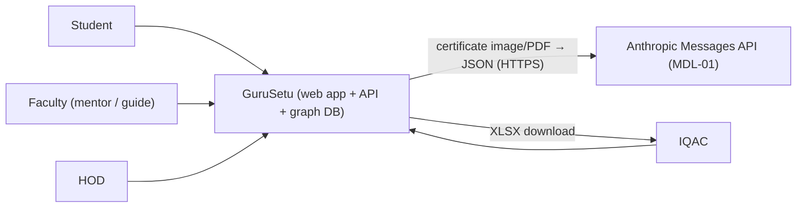
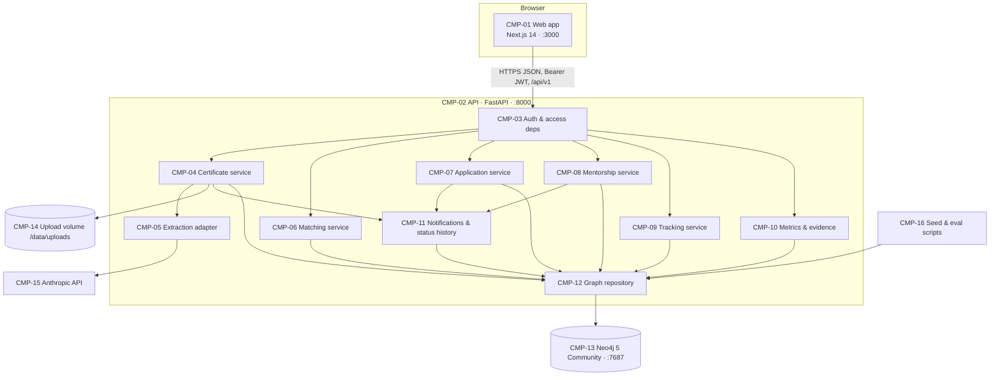
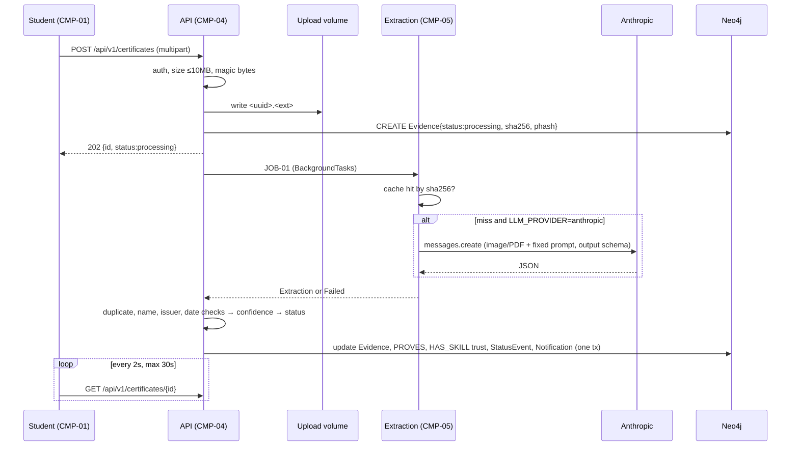

# Architecture
Purpose:      Fix the components, their boundaries, the stack and the key decisions, so backend, frontend and AI work can proceed in parallel against one contract.
Audience:     All four builders and coding agents.
Depends on:   docs/01-product/prd.md
Inputs used:  PRD (REQ-, NFR-, NG-); lessons from the earlier prototype's audit (kept outside this repo; the build is from scratch, D-1)
Status:       Draft v1 | assumptions in this document: A-02, A-04, A-05, A-06, A-13, A-14

Decision records (§8) and project structure (§9) are sections of this document. Security has its own document: [security-and-privacy.md](../08-security/security-and-privacy.md).

## 1. System context



The only external system is the Anthropic API, used for certificate extraction. It is optional at runtime (NFR-04). Nothing else leaves the machine.

## 2. Containers and components



| ID | Component | Responsibility | Public interface | Depends on |
|---|---|---|---|---|
| CMP-01 | Web app | All screens (SCR-); role-based navigation; one API client | Browser routes in [ux-flows.md](../05-frontend/ux-flows.md) | CMP-02 via `openapi.yaml` |
| CMP-02 | API | HTTP surface; validation; error model | [openapi.yaml](../04-backend/openapi.yaml) | CMP-03..12 |
| CMP-03 | Auth & access deps | Login, JWT issue/verify, `current_user`, `require_role(...)`, scope helpers (`assert_mentor_of`, `assert_owner_of_opening`) | FastAPI dependencies | CMP-12 |
| CMP-04 | Certificate service | Upload intake, verification checks, confidence, routing, review, trust recompute | API-005..011; JOB-01 | CMP-05, CMP-06 (concept normalisation), CMP-11, CMP-12, CMP-14 |
| CMP-05 | Extraction adapter | Cache lookup by SHA-256; MDL-01 call; schema validation | `extract(file_bytes, media_type) -> Extraction \| ExtractionFailed` | CMP-15 |
| CMP-06 | Matching service | MDL-02 embeddings, concept normalisation and SIMILAR_TO, hybrid scorer, fit, candidates, why-paths, skill gaps | API-012..016, 020, 021; `recompute_embedding(student_id)` | CMP-12 |
| CMP-07 | Application service | Application state machine; guide link on accept | API-017..019 | CMP-08 (guide link), CMP-11, CMP-12 |
| CMP-08 | Mentorship service | Allotment, sessions, attendance, confirmation, action items, issues, feedback, endorsement | API-022, 023, 026..032, 041..043, 045 | CMP-04 (endorsement trust), CMP-11, CMP-12 |
| CMP-09 | Tracking service | Needs-attention rules, mentor home, Mentee 360, student mentorship page, reminders | API-024, 025, 029, 039 | CMP-12 |
| CMP-10 | Metrics & evidence | MET- computations, dashboard, drill-down, XLSX exports, track record | API-033..036, 044 | CMP-09 (flags), CMP-12 |
| CMP-11 | Notifications & status history | Write `Notification` and `StatusEvent` nodes inside the caller's transaction | `notify(tx, ...)`, `record_status(tx, ...)`; API-037, 038 | CMP-12 |
| CMP-12 | Graph repository | Neo4j driver singleton, transactions, parameterised Cypher only | `run_read`, `run_write(tx_fn)` | CMP-13 |
| CMP-13 | Neo4j | Graph store and vector indexes | Bolt :7687; schema in [schema.cypher](../04-backend/schema.cypher) | none |
| CMP-14 | Upload volume | Original certificate files under random names | Filesystem path from `UPLOAD_DIR` | none |
| CMP-15 | Anthropic API | Vision extraction (MDL-01) | HTTPS Messages API | external |
| CMP-16 | Seed & eval scripts | `scripts.seed`, `scripts.eval_match`, `scripts.build_extraction_cache` | CLI | CMP-06, CMP-12 |

### 2.1 Module dependency order (which must exist before which)
1. CMP-13 → CMP-12 (driver, `schema.cypher` applied on startup)
2. CMP-03 (login, deps) and CMP-11 (notify, status history)
3. CMP-06 concept normalisation and embeddings (MDL-02), required by the seed and by CMP-04
4. CMP-16 seed (needs 2–3, so every later module has data)
5. CMP-05 → CMP-04 (certificates) and CMP-07 (applications) → CMP-06 scorer/fit
6. CMP-08 (mentorship) → CMP-09 (tracking) → CMP-10 (metrics, exports)
7. CMP-01 screens can start against `openapi.yaml` examples at step 1, and switch to the live API per module.

## 3. Key flows

### 3.1 Certificate upload and verification (crosses the external-API trust boundary)


### 3.2 Session log (one transaction, many mentees)
```mermaid
sequenceDiagram
  participant M as Mentor (CMP-01)
  participant A as API (CMP-08)
  participant D as Neo4j
  M->>A: POST /api/v1/sessions {attendees[], topics[], notes, action_items[], issues[]}
  A->>A: validate; every attendee ∈ mentor's active MENTORS
  A->>D: one write tx: Session, ATTENDED_BY×n, ActionItem×k, Issue×j, StatusEvent, Notification per present attendee
  D-->>A: commit
  A-->>M: 201 SessionDetail
```
If any step fails, the transaction rolls back and nothing is saved (FM-06).

### 3.3 Fit Check (read path)
`GET /openings/{id}/fit` → CMP-06 reads the opening's REQUIRES concepts with IDF, the student's HAS_SKILL edges with trust, the SIMILAR_TO neighbours, and both embeddings, in one read query. It then computes the score in Python (formula in [ai-system.md §4](../06-ai/ai-system.md)). There is no LLM on this path.

## 4. Technology stack

| Layer | Choice | Version | Reason | Rejected alternative |
|---|---|---|---|---|
| Backend language | Python | 3.12 | Current, supported by every dependency below [VERIFY: wheels for torch and sentence-transformers on 3.12] | — |
| API framework | FastAPI + Pydantic v2 | pin at hour 0 [VERIFY: pypi.org/project/fastapi] | Response models on every route (SEC-01); the team knows it | Flask (no built-in response models) |
| Database | Neo4j Community | 5.26 LTS [VERIFY: hub.docker.com/_/neo4j] | Existing graph model; native vector index; no APOC needed | Postgres + pgvector (rewrite) |
| DB driver | `neo4j` (Python) | 5.x | Official | — |
| Embeddings (MDL-02) | `sentence-transformers` + `all-MiniLM-L6-v2` | 384-d | Small and fast on CPU; the vector indexes in schema.cypher are 384-d | paraphrase-albert-small-v2 (768-d would need different indexes) |
| LLM (MDL-01) | Anthropic Python SDK, `claude-opus-5-5` | SDK pinned at hour 0 [VERIFY: pypi.org/project/anthropic] | Vision + PDF input + structured outputs | Self-hosted OCR (accuracy, time) |
| Image hashing | Pillow, `imagehash` | 4.3.x | Perceptual hash for duplicates | — |
| PDF rendering | `pypdfium2` | 4.x | Renders page 1 to PNG for pHash; no system deps | pdf2image (needs poppler) |
| Fuzzy match | `rapidfuzz` | 3.x | Name match `token_set_ratio` | — |
| XLSX export | `openpyxl` | 3.1.x | REQ-017 | PDF (layout time) |
| Auth | `bcrypt` (used directly, cost 12) + `PyJWT`, HS256 | pin at hour 0 [VERIFY: pypi] | Seeded accounts only (NG-01); no extra wrapper layer | OAuth (NG-07) |
| Frontend | Next.js App Router, TypeScript, Tailwind | 14.x (pin at hour 0) [VERIFY: create-next-app flags] | Team knows it; scaffolded fresh in T0.P3.1 | — |
| HTTP client | axios, one instance in `src/lib/api.ts` | pin at hour 0 | Interceptors for the token and problem+json | `fetch` (more code for the same interceptors) |
| Charts | `recharts` | 2.x | HOD dashboard bars | Chart.js |
| Graph view (P1) | `react-force-graph-2d` | 1.x | REQ-020 | Cytoscape (heavier) |
| Runtime | Docker Compose v2 | — | One command for the demo (NFR-08) | — |

## 5. Cross-cutting design

- **Configuration:** all settings come from environment variables through `app/core/config.py` (pydantic-settings). Each one is listed once in [backend.md §8](../04-backend/backend.md). Business thresholds (45 days, 14 days, and so on) are settings, not literals.
- **Error handling:** every error response is `application/problem+json` with a stable `code` ([backend.md §3](../04-backend/backend.md)). Handlers raise `ApiError(code, status, detail)`. A global handler maps uncaught exceptions to 500 `INTERNAL` and never swallows `HTTPException` (fixes audit H5).
- **Logging:** JSON logs to stdout with `request_id` (from the `X-Request-ID` header or generated), `user_id`, route, status and latency. What must never be logged is listed in security SEC-15.
- **Auth:** a Bearer JWT carries `{sub: user_id, role, exp}`. Every route except API-001 and API-040 depends on `current_user`. Role and ownership checks happen in deps, before service code. Details are in the security doc.
- **Transactions:** every write that touches more than one node runs in one Neo4j write transaction through `run_write(tx_fn)`. Notifications and StatusEvents are written inside the same transaction as the change they describe.
- **Concurrency:** single API process, 1 uvicorn worker (A-13). Duplicate-apply protection comes from a `MERGE` on the `APPLIED_TO` relationship, plus a check-then-create inside one transaction.
- **Derived state:** overdue, needs-attention, unconfirmed and reminders are computed at read time from stored dates and statuses. No scheduler exists (ADR-05).
- **Time:** timestamps are stored as UTC ISO-8601 strings with a `Z` suffix. Calendar dates (session date, due date, term dates) are `YYYY-MM-DD` in Asia/Kolkata. "Today" means today in Asia/Kolkata.
- **Caching:** extraction results are cached on disk by SHA-256 (CMP-05). Nothing else is cached; seed scale is small (NFR-01).

## 6. Quality attribute strategy

| NFR | Mechanism |
|---|---|
| NFR-01 latency | One Cypher read per screen endpoint; indexes per [schema.cypher](../04-backend/schema.cypher); scorer in Python over ≤ 60 students × ≤ 12 openings |
| NFR-02 extraction time | JOB-01 runs in the background with polling; SHA-256 cache; 25 s timeout on MDL-01 |
| NFR-03 session logging | Group session form with "select all mentees" and topic chips (SCR-08) |
| NFR-04 offline | `LLM_PROVIDER=none`; cache committed for all seed files; MiniLM baked into the image; no CDN fonts |
| NFR-05/06 a11y, responsive | Tailwind, semantic HTML; rules in ux-flows §5 |
| NFR-07 uploads | Size check while streaming, plus magic-byte check (SEC-06) |
| NFR-08/10 setup, reset | Compose healthchecks; idempotent `scripts.seed --reset` |
| NFR-09 cost | Cache; `effort: "low"`; one call per uncached file; `MAX_LLM_CALLS_PER_DAY` |

## 7. Boundaries and extension points

- The system does not integrate any external academic system (NG-07). `AcademicRecord` (ENT-08) is the extension point for an AUMS import.
- A criterion mapping is data (`Criterion` nodes plus a draft code on export rows), so a framework change is a seed update, not a code change.
- `MENTORS.type` is an enum, so peer or alumni mentors (NG-13) would be a new value, not a new model.

## 8. Decision records

| ID | Context | Decision | Alternatives | Consequences |
|---|---|---|---|---|
| ADR-01 | The earlier GuruSetu prototype exists, but its repos are not available here and its Genesis reuse status is unconfirmed; 15 h budget, 4 people | **Build from scratch** in this repo: scaffold `backend/` and `frontend/` at hour 0 (A-05, D-1) | Copy and repair the old code | No dependency on old repos or the prior-code rule; Phase 1 writes auth, core and the app shell instead of repairing them (about +2 h across P2 and P3 [I]) |
| ADR-02 | Graph relationships are central (mentors, skills, similar concepts) and vector search is needed | Neo4j is the only datastore | Add Postgres for mentoring records | One query language; no joins across stores; no SQL DDL (schema is `schema.cypher` plus Pydantic models) |
| ADR-03 | The earlier prototype had duplicate routers with IDOR holes (C3, M1) and open registration and password reset | Never build: recommender, faculty and student portfolio routers, collaboration routes, `/users/upload-profile-picture`, `/auth/register`, `/auth/verify-identity`, `/auth/reset-password`. Every route lives under `/api/v1/<area>` | Copy the old routers and patch each | Avoids those holes by construction (C2/C3/H7); NG-01, NG-02 and NG-10 follow |
| ADR-04 | Extraction takes 3–20 s | FastAPI `BackgroundTasks` plus client polling (JOB-01) | Celery + Redis queue | No new infrastructure; work is lost if the process restarts mid-job, so on startup any certificate still `processing` for > 60 s is set to `failed` (FM-02) |
| ADR-05 | Reminders and flags depend on dates | Compute at read time | APScheduler cron | No background process; flags always reflect current data |
| ADR-06 | Audit trail is needed on 5 object types (REQ-018) | `StatusEvent` nodes keyed by `entity_id` | A list property on each node | One timeline query; Neo4j cannot store lists of maps |
| ADR-07 | LLM output is untrusted and non-deterministic | LLM extracts fields only; trust and routing are deterministic code (ai-system §3) | LLM judges authenticity | Explainable; injection cannot certify a skill |
| ADR-08 | Need vision extraction to a fixed schema | `claude-opus-5-5`, structured output, `effort: "low"`, SHA-256 cache, `LLM_PROVIDER=none` switch | Smaller model; OCR + regex | Small cost per call (NFR-09); the switch covers venues without network |
| ADR-09 | Token storage for a 15 h build: localStorage is the simplest with Bearer headers | Keep it for the demo; expiry 480 min; strict output encoding | httpOnly cookie + CSRF | XSS would expose the token; accepted residual risk (security §9) |
| ADR-10 | Evidence must be editable by IQAC | XLSX via openpyxl | PDF | Coordinators can edit drafts; no PDF layout work |
| ADR-11 | Routes need one consistent shape from the start | All routes go under `/api/v1/<area>`, one router file per area | Ad-hoc paths per feature | The frontend uses one client (`src/lib/api.ts`) and generated types |
| ADR-12 | HOD and IQAC need overlapping views | One Coordinator area; content by role | Two apps | Less UI work; role checks on the server decide fields |
| ADR-13 | A third-party image host would need an external account and would expose uploads by public URL | Local volume `UPLOAD_DIR`; no Cloudinary | Cloudinary | No external account needed; files are served only through API-011 |

## 9. Project structure

```
/                         repo root
  AGENTS.md               agent entry file
  CLAUDE.md               "@AGENTS.md"
  docker-compose.yml      neo4j, backend, frontend (environments doc §2)
  docs/                   this spec pack
  tools/                  ownership.txt + check_ownership.py (one owner per file; docs/phases/parallel-work.md)
  backend/
    Dockerfile            CMD uvicorn app.main:app (fixes audit H6)
    requirements.txt      pinned
    app/
      main.py             app factory, CORS, routers, error handlers, startup (schema, stale-job sweep)
      core/               config.py, database.py (CMP-12), security.py (hash, JWT), errors.py
      api/deps.py         current_user, require_role, scope assertions (CMP-03)
      api/v1/             auto-discovered by main.py (no registration edits): auth.py, students.py, certificates.py,
                          match.py (P1: API-012/013/015/016/020/021), openings_write.py (API-014), applications.py,
                          mentorship.py, tracking.py, dept.py, evidence.py, notifications.py, health.py,
                          endorsements.py (P1: API-041)
      schemas/            generated.py (datamodel-codegen from openapi.yaml; never hand-edited) + thin per-area wrappers
      services/           certificates.py, applications.py, mentorship.py, tracking.py, jobs.py (startup hook, JOB-02),
                          metrics.py, evidence_export.py, notify.py, status_history.py
      ml/                 __init__.py (startup hook), embedding.py (MDL-02), concepts.py, seed_hooks.py, scorer.py, extraction.py (MDL-01 adapter),
                          verification.py (checks + confidence), trust.py (PROVES + trust recompute, backend §6.2),
                          prompts/extract_certificate_v1.md, schemas/certificate_extraction.schema.json
      repos/              Cypher per area: certificates_repo.py, mentorship_repo.py, ... (CMP-12 users);
                          match_repo.py and ml_repo.py are P1-owned (all Cypher used by `ml/`: concepts, embeddings, trust, duplicate lookups)
    schema/schema.cypher  copy of docs/04-backend/schema.cypher, applied on startup
    scripts/              seed.py, eval_match.py, build_extraction_cache.py
    seed/                 users.json, openings.json, concepts.json, aliases.json, issuers.json,
                          sessions.json, academics.json, certificates/*.png|pdf, labels/match_labels.csv
    extraction_cache/     <sha256>.json for every seed certificate (committed)
    tests/                pytest: test_security.py, test_certificates.py, test_matching.py,
                          test_applications.py, test_mentorship.py, test_tracking.py, test_metrics.py
  frontend/
    src/app/              routes per ux-flows §2 (login, student/*, faculty/*, coordinator/*, reviews, notifications)
    src/components/       shared components (ux-flows §7)
    src/lib/api.ts        single axios instance: base URL, Bearer header, 401 → /login
    src/lib/types.ts      types generated from openapi.yaml (openapi-typescript)
    src/components/AuthGuard.tsx  client-side guard in each role layout: no token or wrong role → /login (UX only; the server enforces auth)
    e2e/                  Playwright primary-flow test (P1)
```

**Rules:**
- `api/v1/*` may import `deps`, `schemas` and `services` only.
- `services` may import `repos`, `ml` and other services listed as dependencies in §2.
- `ml` may import `repos` (only `ml_repo.py` and `match_repo.py`, both P1-owned) and `core`. `ml` functions that read or write the database take a `tx` and call these repo functions; they contain no Cypher themselves.
- `repos` import only `core.database`.
- No Cypher outside `repos/` (and `scripts/seed.py`).
- Frontend pages call the API only through `src/lib/api.ts`.
- `uploads/` is a Docker volume and is gitignored; never commit uploaded files (SEC-14).

**Naming:** Python `snake_case`; JSON fields `snake_case`; Neo4j labels `PascalCase`, relationships `UPPER_SNAKE`, properties `snake_case`; React components `PascalCase.tsx`.

**First-run commands:** `cp docs/10-devops/env.example .env` → `docker compose up -d --build` → `docker compose exec backend python -m scripts.seed --reset` → open http://localhost:3000. Tests: `docker compose exec backend pytest -q`. Lint: `ruff check backend` and `npm --prefix frontend run lint`.

## Verify

1. Run `docker compose up -d --build`; then `curl -s localhost:8000/api/v1/health` returns `{"status":"ok","neo4j":"up","llm_provider":"anthropic"}` (or `"none"`).
2. Run `grep -rn "run(" backend/app --include=*.py | grep -v repos/ | grep -v core/database.py`: no Cypher calls outside `repos/`.
3. Run `ls backend/app/api/v1`: only the files listed in §9 exist, with no `dashboard.py` and no `recommendations.py`.
4. Run `python tools/check_ownership.py --who backend/app/api/v1/match.py`: it prints `P1` (file ownership: docs/phases/parallel-work.md).
