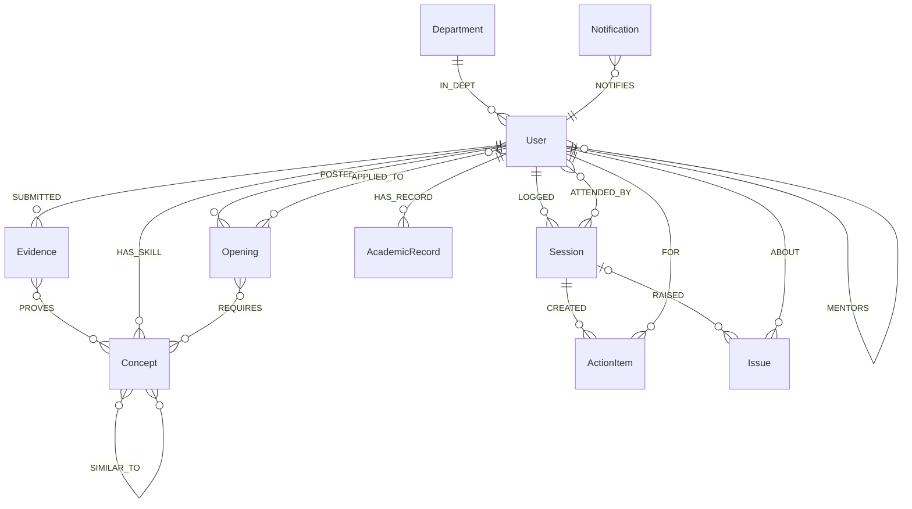
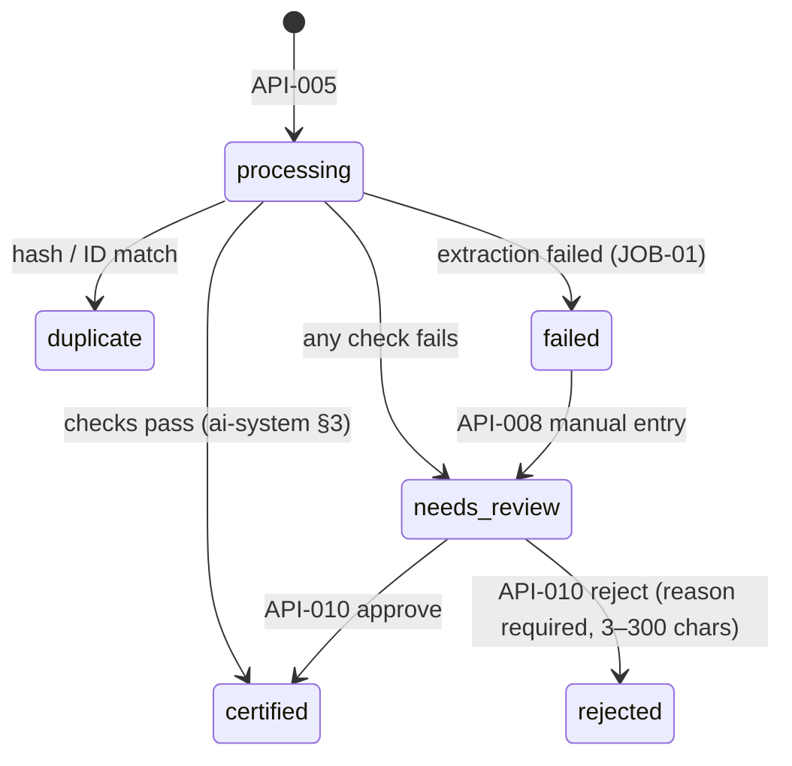

# Backend: Data Model, API and Service Design
Purpose:      Define the graph schema, the HTTP API, the business rules, metrics, jobs and configuration that CMP-02..12 implement.
Audience:     P2 (backend) primarily; P1 for certificates and matching; P3/P4 for API usage.
Depends on:   docs/01-product/prd.md, docs/02-architecture/architecture.md, docs/06-ai/ai-system.md
Inputs used:  REQ-001..038, NFR-01..10, ADR-02..13, audit §2.4 (existing graph model)
Status:       Draft v1 | assumptions in this document: A-08, A-11, A-12, A-13, A-18, A-19

This file covers the data domain, the API spec and the backend design (small-project merge). It is the home of the ENT-, API-, JOB- and MET- IDs.

**Contract files beside it:**
- [schema.cypher](schema.cypher): constraints and indexes. Single source of truth for labels and keys.
- [openapi.yaml](openapi.yaml): routes and payloads. Single source of truth for field names and types.

## 1. Store selection

Neo4j 5 Community is the only datastore (ADR-02). The product is a graph of people, skills, evidence and mentoring links, read along relationships (mentor → mentees → sessions → actions), with a native 384-d vector index. Files live on a volume (CMP-14). There is no SQL, so the DDL contract is `schema.cypher` plus the Pydantic models generated from `openapi.yaml`.

## 2. Data model



**Identifiers:**
- `User.user_id` is the stable key used in tokens and all relationships.
- Every other node has `id`: a UUID v4 string generated by the API, or a fixed slug for seed reference data (Term, Department, Criterion).

**Conventions:**
- Timestamps are UTC ISO-8601 strings ending in `Z`; dates are `YYYY-MM-DD` (architecture §5).
- No soft delete: nothing in P0–P2 is deleted by users. Ended links keep `status:'ended'`.
- Enum values are the lowercase strings listed here and in `openapi.yaml`.

### 2.1 Nodes

**ENT-01 User** (`:User` plus exactly one of `:Student`, `:Faculty`, `:Staff`)

| Field | Type | Null | Constraint / default | Meaning |
|---|---|---|---|---|
| user_id | string (uuid) | no | unique | Identity, JWT `sub` |
| email | string | no | unique, lower-case | Login |
| password_hash | string | no | bcrypt | Never returned (SEC-01) |
| name | string ≤ 80 | no | | Display name |
| role | enum `student\|faculty\|hod\|iqac` | no | `:Staff` for hod/iqac | Access role |
| dept_code | string | no | = Department.code | Department |
| created_at | timestamp | no | | |
| roll_no | string | Student | unique | e.g. `CB.EN.U4CSE24001` |
| year | int 1–5 | Student | | Year of study |
| enrolled_on | date | Student | | Used by `date_ok` (ai-system §3) |
| bio | string ≤ 500 | yes | | Self description |
| interests | list<string> ≤ 10 | yes | `[]` | Topic interests (replaces the old INTERESTED_IN→Concept) |
| embedding | list<float>[384] | yes | | MDL-02; never returned (SEC-01) |
| learner_level | enum `slow\|average\|advanced` | yes | P2, REQ-033 | Set by assigned mentor |
| learner_note | string ≤ 500 | yes | P2 | Intervention note, mentor-only |
| marked_at_risk | bool | yes | false, P2 REQ-029 | Mentor flag |
| employee_id | string | Faculty | unique | |
| designation | string ≤ 60 | Faculty | | e.g. "Assistant Professor" |

**ENT-02 Department**: `code` (unique, e.g. `CSE`), `name`.

**ENT-03 Concept**: `name` (unique, lower-case, ≤ 40), `source` enum `seed|claimed|extracted`, `embedding` list<float>[384].

**ENT-04 Opening**: `id`, `title` (5–120), `description` (≤ 2000), `status` enum `open|closed` (default `open`), `created_at`, `embedding`. Edges: `(:Faculty)-[:POSTED]->(:Opening)-[:REQUIRES]->(:Concept)` (1–10).

**ENT-05 Evidence** (certificate)

| Field | Type | Null | Meaning |
|---|---|---|---|
| id | uuid | no | |
| kind | `'certificate'` | no | Only kind in this build |
| status | enum `processing\|certified\|needs_review\|rejected\|duplicate\|failed` | no | §6.1 |
| file_path | string | no | `<UPLOAD_DIR>/<uuid>.<ext>`; never returned |
| media_type | enum `image/jpeg\|image/png\|application/pdf` | no | From magic bytes |
| size_bytes | int | no | ≤ MAX_UPLOAD_MB |
| sha256 | hex string(64) | no | Indexed |
| phash | hex string(16) | yes | null for unreadable files |
| holder_name, title, issuer, certificate_id, verify_url | string ≤ 200 | yes | From MDL-01, cache or manual entry |
| issue_date | date | yes | |
| level | enum (ai-system §2.2) | yes | |
| type | enum (ai-system §2.2) | yes | |
| skills | list<string> ≤ 8 | no | `[]` |
| contains_instructions | bool | no | false |
| confidence | float 0–1 | yes | ai-system §3 |
| reasons | list<string> | no | e.g. `["name_mismatch"]` |
| duplicate_of | uuid | yes | Matching Evidence id |
| source | enum `llm\|cache\|manual` | yes | |
| reviewed_by | user_id | yes | |
| review_reason | string ≤ 300 | yes | Shown to the student only |
| created_at, updated_at | timestamp | no | |

Edges: `(:Student)-[:SUBMITTED]->(:Evidence)-[:PROVES]->(:Concept)` (PROVES is created only when the status is `certified`).

**ENT-06 Issuer**: `name` (unique), `aliases` list<string>, `kind` enum `mooc|university|company|club|government|other`. Seeded from `seed/issuers.json`.

**ENT-07 Term**: `id` (e.g. `2026-ODD`), `name`, `start_date`, `end_date`. The current term is set by `CURRENT_TERM_ID`, or by today's date falling within a term (A-08).

**ENT-08 AcademicRecord** `[MOCK]`: `id`, `term_id`, `cgpa` float 0–10, `attendance_pct` float 0–100, `backlogs` int ≥ 0. Edge: `(:Student)-[:HAS_RECORD]->(:AcademicRecord)`.

**ENT-09 Session**

| Field | Type | Null | Meaning |
|---|---|---|---|
| id | uuid | no | |
| date | date | no | ≤ today; within the current or previous term |
| mode | enum `in_person\|online` | no | |
| kind | enum `individual\|group` | no | `individual` requires exactly 1 attendee |
| context | enum `assigned\|guide` | no | Only `assigned` counts toward compliance (MET-01) |
| opening_id | uuid | yes | Required when context = `guide` |
| topics | list<enum `academic\|attendance\|career\|research\|personal\|other`> 1–6 | no | |
| notes | string ≤ 4000 | yes | Private to the author (REQ-015) |
| confidential | bool | no | false; P1 REQ-036 |
| next_followup | date | yes | > date |
| created_at | timestamp | no | |

Edges: `(:Faculty)-[:LOGGED]->(:Session)-[:ATTENDED_BY]->(:Student)`.

**ENT-10 ActionItem**: `id`, `text` (1–300), `owner` enum `mentee|mentor`, `due_date` (≥ session date), `status` enum `open|done|verified|dropped`, `created_at`, `updated_at`. Edges: `(:Session)-[:CREATED]->(:ActionItem)-[:FOR]->(:Student)`. Overdue is derived (§6.6).

**ENT-11 Issue**: `id`, `category` (topic enum), `text` (1–1000), `status` enum `raised|acknowledged|in_progress|resolved`, `escalated` bool (P1), `confidential` bool (P1), `raised_by` user_id, `raised_by_role` enum `faculty|student`, `raised_at`, `resolved_at` (null until resolved), `resolution` (≤ 1000). Edges: `(:Issue)-[:ABOUT]->(:Student)`, optional `(:Session)-[:RAISED]->(:Issue)`.

**ENT-12 Notification**: `id`, `type` (§6.9), `title` ≤ 120, `body` ≤ 200, `link` (app route), `read` bool, `created_at`. Edge: `(:Notification)-[:NOTIFIES]->(:User)` (old edge name kept).

**ENT-13 Criterion** `[MOCK]` draft: `code` (unique, e.g. `NAAC-5.3.1`), `framework` enum `NAAC|NBA`, `title`, `evidence_types` list<string> (Evidence `type` values that map to it), `metric_ids` list (MET- it supports), `verified` false. Codes are [VERIFY: official NAAC manual, current version].

**ENT-14 StatusEvent**: `id`, `entity_type` enum `evidence|application|mentorship|action_item|issue|session`, `entity_id`, `from_status` (null on creation), `to_status`, `actor_id`, `actor_name`, `note` (≤ 300, never note text from sessions), `at`. Indexed by `entity_id`.

**ENT-15 Counter**: `name`, `date`, `value`. Used only for the LLM daily cap.

**ENT-21 IdempotencyKey**: `key`, `user_id`, `response_ref` (Session id), `created_at`; expires after 24 h (checked on read).

### 2.2 Relationships with properties

| ID | Relationship | Properties | Rules |
|---|---|---|---|
| ENT-16 | `(:Student)-[:HAS_SKILL]->(:Concept)` | `trust_level` int 0–2, `claimed` bool, `evidence_ids` list<uuid>, `endorsed_by` list<user_id> (P2), `updated_at` | One per pair; trust recomputed (§6.2) |
| ENT-17 | `(:Faculty)-[:MENTORS]->(:Student)` | `id` uuid, `type` enum `assigned\|guide`, `status` enum `active\|ended`, `since` date, `until` date\|null, `end_reason` enum `handover\|graduated\|completed\|null`, `opening_id` (guide only) | At most one active `assigned` per student |
| ENT-18 | `(:Student)-[:APPLIED_TO]->(:Opening)` | `id` uuid, `status` enum `pending\|shortlisted\|accepted\|rejected\|completed`, `applied_at`, `updated_at` | One per pair (replaces the old SHORTLISTED edge) |
| ENT-19 | `(:Session)-[:ATTENDED_BY]->(:Student)` | `present` bool, `confirmed_at` timestamp\|null, `feedback` enum `helpful\|not_helpful\|null` (P2), `feedback_comment` ≤ 300 (P2) | |
| ENT-20 | `(:Concept)-[:SIMILAR_TO]-(:Concept)` | `score` float 0–1, `source` enum `model\|override` | Stored once per pair; queried undirected |

Plain relationships: `IN_DEPT`, `POSTED`, `REQUIRES`, `SUBMITTED`, `PROVES`, `LOGGED`, `CREATED`, `FOR`, `RAISED`, `ABOUT`, `HAS_RECORD`, `NOTIFIES`.

### 2.3 Access patterns

| # | Read | Used by | Index |
|---|---|---|---|
| 1 | User by email (login) | API-001 | `user_email` unique |
| 2 | User by user_id (every request) | deps | `user_id` unique |
| 3 | Mentor's active mentees with their sessions, actions and issues this term | API-024 | `user_id`; traversal from the mentor node |
| 4 | Student's full mentoring timeline + StatusEvents | API-025, 029 | `status_event_entity`; `user_id` |
| 5 | Opening's required concepts + IDF counts + student skills + SIMILAR_TO | API-015, 016 | `opening_id`, `concept_name` |
| 6 | Evidence by sha256 / list of (id, phash) for the duplicate scan | JOB-01 | `evidence_sha256`; full scan of ≤ 1,000 phash values in Python |
| 7 | Department aggregates for the current term | API-033, 035 | `user_dept`; `session_date` range |
| 8 | Notifications for a user, newest first | API-037 | traversal + `notification_created` |
| 9 | Review queue: `needs_review` Evidence of the caller's mentees, or the department | API-009 | `evidence_status` |

## 3. API conventions

- **Base path** `/api/v1`. JSON request and response bodies, `snake_case`. Content type `application/json` except API-005 (`multipart/form-data`) and API-035/036 (XLSX).
- **Auth:** `Authorization: Bearer <JWT>` on every route except API-001 and API-040. Role per route is in §4. Ownership and scope rules are in [security §4](../08-security/security-and-privacy.md).
- **Methods:** GET is safe; PATCH is a partial update (omitted fields untouched, fixing audit H3); POST creates; no PUT except API-008 (full replacement of manual fields); no DELETE routes.
- **Status codes:** 200 read/update, 201 create, 202 accepted (API-005), 204 for API-038.
- **Lists:** API-037 and API-034 use cursor pagination (`limit` default 20, max 100; `cursor` opaque; response `{items, next_cursor}`). Every other list is bounded and returned whole (the maximum is stated per route in openapi.yaml).
- **Idempotency:** API-026 accepts an `Idempotency-Key` header (UUID). A replay within 24 h returns the original 201 body.
- **Rate limits:** API-001 10/min per IP; API-005 20/hour per user. A breach returns 429 `RATE_LIMITED` with a `Retry-After` header.
- **CORS:** origins from `CORS_ORIGINS`, methods `GET,POST,PATCH,PUT`, credentials false.

### 3.1 Error model

Every error is RFC 9457 `application/problem+json`:
```json
{"type":"https://gurusetu.local/errors/invalid-transition","title":"Invalid status transition","status":409,
 "detail":"Cannot move application from pending to accepted.","instance":"/api/v1/applications/7f3…","code":"INVALID_TRANSITION",
 "errors":[]}
```
`errors` is present on 422: `[{"field":"date","message":"Session date cannot be in the future."}]`.

| code | HTTP | Meaning | Client action |
|---|---|---|---|
| UNAUTHENTICATED | 401 | Missing or invalid token | Go to /login |
| TOKEN_EXPIRED | 401 | `exp` passed | Go to /login with "Session expired, please log in again." |
| INVALID_CREDENTIALS | 401 | Wrong email/password | Show "Email or password is incorrect." |
| FORBIDDEN | 403 | Role not allowed on this route | Show "You don't have access to this." |
| NOT_FOUND | 404 | Missing, or outside the caller's scope (no existence leak) | Show not-found state |
| METHOD_NOT_ALLOWED | 405 | The route exists but not for this HTTP method | Treat as a client bug |
| VALIDATION_FAILED | 422 | Field errors | Show `errors[]` beside fields |
| NOT_YOUR_MENTEE | 422 | Attendee or student is not linked to this mentor | Show detail |
| ALREADY_APPLIED | 409 | Duplicate application | Show "You have already applied." |
| INVALID_TRANSITION | 409 | Status change not allowed (§6) | Refresh, show detail |
| NOT_PRESENT | 409 | Absent attendee tried to confirm | Hide confirm |
| OPENING_CLOSED | 409 | Apply to a closed opening | Show detail |
| ALREADY_REVIEWED | 409 | Review on an Evidence not in `needs_review` | Refresh queue |
| FILE_TOO_LARGE | 413 | > MAX_UPLOAD_MB | "File is larger than 10 MB." |
| UNSUPPORTED_FILE_TYPE | 415 | Not JPEG/PNG/PDF by magic bytes | "Upload a JPG, PNG or PDF." |
| RATE_LIMITED | 429 | Over limit | Wait `Retry-After` |
| DB_UNAVAILABLE | 503 | Neo4j unreachable | "Service is starting, try again in a moment." |
| INTERNAL | 500 | Unexpected | Generic error; `request_id` shown |

## 4. Endpoints

Roles: S = student, F = faculty, H = hod, I = iqac. "Scope" refers to security §4.

| ID | Method & path | Purpose | Roles (scope) | Success | Errors | REQ | Tier |
|---|---|---|---|---|---|---|---|
| API-001 | POST /auth/login | Email + password → JWT | public | 200 `TokenResponse` | 401, 422, 429 | 031 | P0 |
| API-002 | GET /me | Current user profile | all | 200 `Me` | 401 | 031 | P0 |
| API-003 | GET /students/{student_id} | Student profile with skills and trust | S (self), F (mentor/guide or applicant to own opening), H | 200 `StudentProfile` | 404 | 003, 005 | P0 |
| API-004 | PATCH /me/profile | Update bio, interests, claimed skills (student) | S | 200 `StudentProfile` | 422 | 004 | P0 |
| API-005 | POST /certificates | Upload certificate (field `file`) | S | 202 `Certificate` (status `processing`) | 413, 415, 429 | 001 | P0 |
| API-006 | GET /certificates/{id} | Poll one certificate | S (own), F (mentor of owner), H | 200 `Certificate` | 404 | 001 | P0 |
| API-007 | GET /me/certificates | Own certificates (≤ 100) | S | 200 `Certificate[]` | | 001 | P0 |
| API-008 | PUT /certificates/{id}/manual | Manual fields for a `failed` certificate | S (own) | 200 `Certificate` (`needs_review`) | 404, 409, 422 | 037 | P0 |
| API-009 | GET /reviews/certificates | Review queue (≤ 100) | F (own assigned mentees), H (department) | 200 `ReviewItem[]` | 403 | 002 | P0 |
| API-010 | POST /certificates/{id}/review | Approve or reject `{decision, reason}` | F (assigned mentor of owner), H | 200 `Certificate` | 404, 409, 422 | 002 | P0 |
| API-011 | GET /certificates/{id}/file | Original file stream | S (own), F (mentor of owner), H | 200 binary | 404 | 002 | P0 |
| API-012 | GET /openings | Open openings with my fit summary (student) or all (others), ≤ 50 | all | 200 `OpeningSummary[]` | | 004 | P0 |
| API-013 | GET /openings/{id} | Opening detail | all | 200 `Opening` | 404 | 004 | P0 |
| API-014 | POST /openings | Create opening | F | 201 `Opening` | 422 | 030 | P1 |
| API-015 | GET /openings/{id}/fit?student_id= | Fit Check; `student_id` only for the owner faculty viewing an applicant | S (self), F (owner, applicant only) | 200 `Fit` | 404 | 004 | P0 |
| API-016 | GET /openings/{id}/candidates | Applicants ranked by fit | F (owner) | 200 `Candidate[]` | 404 | 005 | P0 |
| API-017 | POST /openings/{id}/applications | Apply | S | 201 `Application` | 404, 409 | 006 | P0 |
| API-018 | PATCH /applications/{id} | Change status `{status}` | F (owner of opening) | 200 `Application` | 403, 404, 409 | 006 | P0 |
| API-019 | GET /me/applications | Own applications (S) | S | 200 `Application[]` | | 006, 014 | P0 |
| API-020 | GET /openings/{id}/why | Why-paths for the caller | S | 200 `WhyGraph` | 404 | 020 | P1 |
| API-021 | GET /me/skill-gaps | Top 5 unlocking skills | S | 200 `SkillGap[]` | | 021 | P1 |
| API-022 | GET /dept/allotment | Mentors with load + unallotted students | H | 200 `AllotmentView` | 403 | 007 | P0 |
| API-023 | POST /allotments | Assign `{mentor_id, student_ids[]}` (1–30) | H | 200 `AllotmentView` | 403, 404, 422 | 007, 028 | P0 |
| API-024 | GET /me/mentees | Mentor home rows | F | 200 `MenteeRow[]` | 403 | 012, 029 | P0 |
| API-025 | GET /mentees/{student_id}/overview | Mentee 360 | F (mentor/guide), H | 200 `MenteeOverview` | 404 | 013, 032 | P0 |
| API-026 | POST /sessions | Log a session with attendance, action items, issues | F | 201 `SessionDetail` | 422 | 008, 010, 011 | P0 |
| API-027 | GET /sessions/{id} | Session detail (notes only for author) | F (author), S (attendee) | 200 `SessionDetail` | 404 | 008, 015 | P0 |
| API-028 | POST /sessions/{id}/confirm | Mentee confirms attendance | S (attendee) | 200 `SessionDetail` | 404, 409 | 009 | P0 |
| API-029 | GET /me/mentorship | Student mentorship page data | S | 200 `MyMentorship` | | 014 | P0 |
| API-030 | PATCH /action-items/{id} | Change status `{status}` | S (FOR student, `done` only), F (author's session) | 200 `ActionItem` | 403, 404, 409 | 010 | P0 |
| API-031 | POST /issues | Raise issue `{student_id, category, text, session_id?, confidential?}` | F (mentor/guide), S (self, P1) | 201 `Issue` | 404, 422 | 011, 024 | P0 |
| API-032 | PATCH /issues/{id} | `{status?, resolution?, escalated?, confidential?}` | F (mentor of student), H (escalated only) | 200 `Issue` | 403, 404, 409, 422 | 011, 022, 036 | P0 |
| API-033 | GET /dept/dashboard | Department dashboard for the current term | H (names), I (aggregates) | 200 `Dashboard` | 403 | 016 | P0 |
| API-034 | GET /dept/metrics/{metric}/records | Records behind a metric | H, I (no names) | 200 `{items, next_cursor}` | 403, 404 | 019 | P1 |
| API-035 | GET /evidence/mentoring.xlsx | Mentoring pack | H, I | 200 XLSX | 403 | 017 | P0 |
| API-036 | GET /evidence/achievements.xlsx | Achievements list | H, I | 200 XLSX | 403 | 017 | P0 |
| API-037 | GET /me/notifications | Notifications, newest first | all | 200 `{items, next_cursor, unread}` | | 038 | P0 |
| API-038 | POST /me/notifications/{id}/read | Mark read | all (own) | 204 | 404 | 038 | P0 |
| API-039 | GET /me/reminders | Derived reminders (§6.10) | S, F | 200 `Reminder[]` | | 023 | P1 |
| API-040 | GET /health | Liveness + DB + LLM mode | public | 200 `{status, neo4j, llm_provider}` | 503 | — (ops) | P0 |
| API-041 | POST /students/{student_id}/endorsements | Endorse `{concept}` | F (mentor/guide) | 201 `StudentProfile` | 404, 422 | 027 | P2 |
| API-042 | POST /sessions/{id}/feedback | `{feedback, comment?}` | S (present attendee) | 200 | 404, 409 | 034 | P2 |
| API-043 | PATCH /mentees/{student_id} | `{learner_level?, learner_note?, marked_at_risk?}` | F (assigned mentor) | 200 `MenteeOverview` | 404, 422 | 029, 033 | P2 |
| API-044 | GET /faculty/{faculty_id}/track-record | Facts, not ratings | all | 200 `TrackRecord` | 404 | 035 | P2 |
| API-045 | POST /me/meeting-requests | Message to the assigned mentor `{message}` | S | 201 | 404 (no mentor), 422 | 024 | P1 |

### 4.1 Worked examples (seed values)

**API-015** `GET /api/v1/openings/op-edge-ai/fit` as Aarav, before uploads:
```json
{"opening_id":"op-edge-ai","student_id":"u-aarav","score":43.4,
 "components":{"semantic":17.5,"skill":24.8,"concept":1.1},
 "weights":{"semantic":0.25,"skill":0.6,"concept":0.15},
 "verdict":"close","verdict_text":"Close: certify the skills below to improve your fit",
 "chips":[
  {"concept":"python","kind":"matched","trust_level":1,"source":{"evidence_id":"ev-aarav-python","title":"Python for Everybody"}},
  {"concept":"pytorch","kind":"claimed_only","trust_level":0},
  {"concept":"deep learning","kind":"claimed_only","trust_level":0},
  {"concept":"computer vision","kind":"near","via":"deep learning","similarity":0.7,"trust_level":0}],
 "gains":[{"concept":"computer vision","score_if_certified":55.0},{"concept":"deep learning","score_if_certified":51.2},{"concept":"pytorch","score_if_certified":50.1}],
 "note":null}
```
(Semantic value illustrative, as in ai-system §4.)

**API-026** `POST /api/v1/sessions` as Dr. Meera, `Idempotency-Key: 5b1f…`:
```json
{"date":"2026-10-10","mode":"in_person","kind":"group","context":"assigned","opening_id":null,
 "attendees":[{"student_id":"u-aarav","present":true},{"student_id":"u-diya","present":false}],
 "topics":["academic","attendance"],"notes":"Discussed mid-sem prep; Diya absent again.","confidential":false,
 "next_followup":"2026-10-24",
 "action_items":[{"student_id":"u-aarav","text":"Finish DL assignment 3","owner":"mentee","due_date":"2026-10-17"}],
 "issues":[{"student_id":"u-diya","category":"attendance","text":"Attendance below 75% in two courses"}]}
```
Response 201: `SessionDetail` with `id`, the same fields, `attendees[].confirmed_at:null`, created `action_items[]` and `issues[]` with ids and status.

**API-024** row:
```json
{"student_id":"u-karthik","name":"Karthik S","roll_no":"CB.EN.U4CSE24017","mentorship_type":"assigned",
 "meetings_this_term":2,"meetings_required":2,"last_session_date":"2026-08-11","open_actions":2,"overdue_actions":1,
 "open_issues":1,"unconfirmed_sessions":0,"needs_attention":true,
 "attention_reasons":["no_recent_session","overdue_action"]}
```

**API-033** (HOD; the IQAC response omits `needs_attention_list` and `escalated_issues`; `escalated_issues` is filled from P1 REQ-022 and is `[]` before that):
```json
{"term":{"id":"2026-ODD","name":"Odd semester 2026"},"students_total":50,"students_allotted":48,"unallotted":2,
 "ratio":"1:12","compliance_pct":91.7,"overdue_actions":8,"pending_reviews":1,
 "mentors":[{"mentor_id":"u-meera","name":"Dr. Meera Raman","mentee_count":13,"overloaded":false,"meetings_held":4,
             "mentees_compliant":13,"compliance_pct":100.0,"issues_raised":5,"issues_resolved":4,"overdue_actions":2}],
 "issues_by_category":[{"category":"attendance","raised":6,"resolved":5},{"category":"confidential","raised":1,"resolved":0}],
 "achievements_by_type":[{"type":"course","count":14},{"type":"hackathon","count":5}],
 "needs_attention_list":[{"student_id":"u-karthik","name":"Karthik S","mentor_name":"Dr. Meera Raman","reasons":["no_recent_session","overdue_action"]}]}
```

## 5. Layering

`api/v1/<area>.py` (parse, deps, response model) → `services/<area>.py` (rules in §6, transactions) → `repos/<area>_repo.py` (Cypher). Services own transactions: a write service function receives a `tx` from `run_write` and calls `notify(tx, ...)` and `record_status(tx, ...)` before commit.

## 6. Business rules

### 6.1 Certificate status machine (refines PRD v2 §7)

- `duplicate`, `certified` and `rejected` are terminal for the reviewer. A certified certificate cannot be un-certified in this build.
- Each transition writes a StatusEvent and notifies the student (`certificate_result`). Entering `needs_review` also notifies the assigned mentor (`review_needed`).

### 6.2 Trust recompute (`recompute_skill(student, concept)`)
1. `cert_ids` = ids of `certified` Evidence that PROVES the concept and is SUBMITTED by the student.
2. `trust = 2` if `endorsed_by` is non-empty (P2); else `1` if `cert_ids` is non-empty; else `0` if `claimed`; else delete the HAS_SKILL edge.
3. Write `trust_level`, `evidence_ids = cert_ids` and `updated_at`, then recompute the student embedding (ai-system §5).

Triggers: an Evidence entering `certified`; API-004 changing claimed skills; API-041 (P2).

### 6.3 Application status machine
| From \ To | shortlisted | accepted | rejected | completed |
|---|---|---|---|---|
| pending | ✔ | ✘ | ✔ | ✘ |
| shortlisted | — | ✔ | ✔ | ✘ |
| accepted | ✘ | — | ✘ | ✔ |
| rejected, completed | ✘ | ✘ | ✘ | ✘ |

- A disallowed transition returns 409 `INVALID_TRANSITION`.
- On `accepted`: in the same transaction, `MERGE (f)-[:MENTORS {type:'guide', opening_id}]->(s)` with `status:'active'` and `since: today`.
- On `completed`: set the guide link to `status:'ended'` with `end_reason:'completed'`.
- Every transition: StatusEvent plus a notification to the student (`application_status`).
- On apply: notify the owner (`application_received`).
- Apply checks, in order: opening exists (404), status `open` (409 `OPENING_CLOSED`), no existing APPLIED_TO (409 `ALREADY_APPLIED`).

### 6.4 Needs-attention rules (home of these rules; thresholds in §8)
Computed per active MENTORS link for the mentor's home (API-024) and for the HOD list (API-033):

| Reason | Applies to | Rule |
|---|---|---|
| `no_recent_session` | assigned | No Session by this mentor with context `assigned` where the student is `present` within the last `ATTENTION_NO_SESSION_DAYS` (45) days, and `MENTORS.since` is more than 45 days ago |
| `no_meeting_this_term` | assigned | `meetings_this_term = 0` and today > term start + 50% of the term length |
| `overdue_action` | both | Any ActionItem FOR the student, from this mentor's sessions, with status `open` and `due_date < today` |
| `stale_issue` | both | Any Issue ABOUT the student, not `resolved`, raised more than `ISSUE_STALE_DAYS` (14) days ago, visible to this mentor |
| `marked_at_risk` (P2) | assigned | `Student.marked_at_risk = true` |
| `suggested_at_risk` (P2) | assigned | Current-term AcademicRecord `attendance_pct < 75`, or a CGPA drop ≥ 1.0 against the previous term |

- `meetings_this_term` = count of Sessions LOGGED by this mentor, context `assigned`, `date` within the current term, with ATTENDED_BY `present=true` for the student.
- `unconfirmed_sessions` = such sessions older than `SESSION_CONFIRM_DAYS` (7) days with `confirmed_at` null.
- Sort order: `needs_attention` first, then by number of reasons, then by name.

### 6.5 Session rules
- Validation is in REQ-008.
- Every attendee must have an active MENTORS link to the author: `assigned` for context `assigned`, or `guide` with a matching `opening_id` for context `guide`. Otherwise 422 `NOT_YOUR_MENTEE`.
- `kind = individual` requires exactly 1 attendee.
- `action_items[].student_id` and `issues[].student_id` must be attendees (present or absent).
- One transaction: Session, ATTENDED_BY×n, ActionItem×k (status `open`), Issue×j (status `raised`), a StatusEvent per created item, and notifications (`session_logged` to each present attendee; `action_assigned` per mentee-owned item).
- **Confirm (API-028):** the caller must be an attendee (404 otherwise), `present = true` (409 `NOT_PRESENT` otherwise), and setting `confirmed_at` is idempotent (a second call returns 200 unchanged).

### 6.6 Action item rules
- `overdue = status == 'open' and due_date < today`.
- Allowed transitions:
  - the mentee (FOR student) may do `open → done`;
  - the author mentor may do `done → verified`, `open|done → dropped` and `done → open` (reopen);
  - anything else returns 409 `INVALID_TRANSITION`.
- A role not allowed to change the item returns 403.
- Every change writes a StatusEvent.

### 6.7 Issue rules
- **P0:** `raised → resolved` with a resolution of 1–1000 characters. **P1** adds `raised → acknowledged → in_progress → resolved`, and `escalated: true` from any unresolved state.
- Escalation notifies the department's HOD (`issue_escalated`). From then on the HOD may read the text and resolve it. Unresolved escalated issues are listed in API-033 `escalated_issues` (HOD only; omitted for IQAC).
- `confidential` (P1) may be set by the mentor at creation or later. Visibility is in security §4. A confidential issue cannot be escalated (409 `INVALID_TRANSITION`, detail "Confidential issues cannot be escalated").
- A student-raised issue (P1) notifies the assigned mentor (`issue_raised_by_mentee`).

### 6.8 Allotment rules
- For each student in `student_ids`, in one transaction:
  - if an active `assigned` link exists to a different mentor, set it to `ended`, `until: today`, `end_reason: 'handover'`;
  - if it already points to the target mentor, it is a no-op;
  - then `CREATE` the new active link with `since: today`, and notify the student (`allotted`).
- `overloaded` = active assigned mentees > `MENTOR_LOAD_WARN` (20).
- `mentor_id` must be `:Faculty` in the same department (404 otherwise).

### 6.9 Notification catalogue
| type | Recipient | Trigger | Title template | link |
|---|---|---|---|---|
| application_received | Opening owner | API-017 | "{student} applied to {opening}" | /faculty/openings/{id} |
| application_status | Student | API-018 | "Your application to {opening} is now {status}" | /student/mentorship |
| certificate_result | Student | §6.1 transitions out of `processing`/`needs_review` | "Certificate '{title}' is {status_label}" | /student/certificates |
| review_needed | Assigned mentor | → `needs_review` | "A certificate from {student} needs review" | /reviews |
| allotted | Student | API-023 | "Your mentor is now {mentor}" | /student/mentorship |
| session_logged | Present attendee | API-026 | "Please confirm your session on {date}" | /student/mentorship |
| action_assigned | Student | API-026 (mentee-owned item) | "New action item due {due_date}" | /student/mentorship |
| issue_escalated (P1) | HOD | API-032 escalated | "Issue escalated by {mentor}" | /coordinator |
| issue_raised_by_mentee (P1) | Assigned mentor | API-031 by student | "{student} raised an issue" | /faculty/mentees/{id} |
| meeting_request (P1) | Assigned mentor | API-045 | "{student} requested a meeting" (body = the student's own message) | /faculty/mentees/{id} |

Notification bodies never contain session notes or issue text.

### 6.10 Reminders (P1, computed on read by API-039)
| Kind | For | Rule |
|---|---|---|
| `meetings_due` | Mentor (per mentee), student | `meetings_this_term < MIN_MEETINGS_PER_TERM` and term end − today ≤ `REMINDER_TERM_END_DAYS` (30) |
| `action_overdue` | Mentor and the FOR student | §6.6 overdue |
| `issue_stale` | Mentor | §6.4 `stale_issue` |
| `session_unconfirmed` | Student | Present, unconfirmed, older than 7 days |

## 7. Metrics (home of MET- definitions; scope: department, current term, assigned context)

| ID | Metric | Definition |
|---|---|---|
| MET-01 | compliance_pct | `100 × |{s allotted : meetings_this_term(s) ≥ MIN_MEETINGS_PER_TERM}| / |allotted|`, one decimal; per mentor and overall |
| MET-02 | ratio | `"1:" + round(allotted / count(mentors with ≥ 1 active assigned mentee))` |
| MET-03 | issues_raised | Issues ABOUT department students with `raised_at` in the term; grouped by category, with confidential issues under `"confidential"` (REQ-036) |
| MET-04 | issues_resolved | Issues with `resolved_at` in the term; same grouping |
| MET-05 | meetings_held | Distinct Sessions by the mentor, context `assigned`, date in the term |
| MET-06 | overdue_actions | Count of overdue ActionItems (§6.6) for department students |
| MET-07 | mentor_load | Active assigned mentees per mentor; `overloaded` per §6.8 |
| MET-08 | achievements_by_type | `certified` Evidence of department students with `issue_date` in the academic year (Jul 1 – Jun 30), grouped by `type` and `level` |
| MET-09 | needs_attention_count | Students with ≥ 1 reason from §6.4 |
| MET-10 | pending_reviews | Evidence in `needs_review` for department students |
| MET-11 | learner_levels (P2) | Count of assigned mentees per `learner_level` |
| MET-12 | confirmed_share | Of present attendances in the term, the % with `confirmed_at` set (export only) |

The drill-down `API-034 /dept/metrics/{metric}/records` accepts `metric ∈ {compliance, issues_raised, issues_resolved, overdue_actions, achievements, needs_attention, pending_reviews}` and returns exactly the rows counted (REQ-019). For IQAC, student names and roll numbers are replaced by a per-response pseudonym (`Student 01`…).

**Export layouts (REQ-017):**
- **`mentoring.xlsx`:**
  - `README`: A1 DRAFT notice; generated_at, term, generated_by role; draft criterion codes from ENT-13.
  - `Mentors`: name, designation, employee_id, mentee_count.
  - `Allotment`: mentor, roll_no, student name, since.
  - `Summary`: MET-01, 02, 03, 04, 06, 12, and MET-11 (P2).
  - `Mentor-wise`: mentor, meetings_held, mentees, mentees_compliant, compliance_pct, then raised and resolved per category.
- **`achievements.xlsx`:**
  - `README`: same as above.
  - `Achievements`: roll_no, name, title, issuer, issue_date, level, type, certificate_id, status, reviewed_by, draft criterion code.
  - `By type`: MET-08.
- Every string cell that starts with `= + - @` is prefixed with `'` (SEC-18).

## 8. Configuration

All variables are listed in [env.example](../10-devops/env.example).

| Variable | Type | Default | Secret | Meaning |
|---|---|---|---|---|
| NEO4J_URI | url | `bolt://neo4j:7687` | no | |
| NEO4J_USER | string | `neo4j` | no | |
| NEO4J_PASSWORD | string | — | yes | ≥ 12 chars |
| JWT_SECRET_KEY | string | — | yes | ≥ 32 random chars; app refuses to start otherwise |
| JWT_EXPIRE_MINUTES | int | 480 | no | ADR-09 |
| CORS_ORIGINS | csv | `http://localhost:3000` | no | |
| UPLOAD_DIR | path | `/data/uploads` | no | |
| MAX_UPLOAD_MB | int | 10 | no | NFR-07 |
| LLM_PROVIDER | enum `groq\|anthropic\|none` | `groq` | no | ADR-08; D-2 moved MDL-01 to Groq |
| ANTHROPIC_API_KEY | string | — | yes | Unused; kept for the `anthropic` branch |
| GROQ_API_KEY | string | — | yes | Required when LLM_PROVIDER=groq (D-2) |
| LLM_MODEL | string | `qwen/qwen3.8-27b` | no | MDL-01 (D-2) |
| LLM_TIMEOUT_S | int | 25 | no | |
| MAX_LLM_CALLS_PER_DAY | int | 200 | no | NFR-09 |
| EXTRACTION_CACHE_DIR | path | `/app/extraction_cache` | no | |
| EMBEDDING_MODEL | string | `sentence-transformers/all-MiniLM-L6-v2` | no | MDL-02 |
| HF_HOME | path | `/models` | no | Baked at build |
| CERT_AUTO_CERTIFY_MIN | float | 0.85 | no | ai-system §3 |
| NAME_MATCH_MIN | int | 85 | no | |
| PHASH_MAX_DISTANCE | int | 6 | no | |
| TAMPER_CHECK_ENABLED | bool | false | no | P1 REQ-025 |
| ELA_THRESHOLD | float | 12.0 | no | A-17 |
| FIT_READY_MIN | float | 65 | no | ai-system §4 |
| FIT_CLOSE_MIN | float | 40 | no | |
| SIM_MIN | float | 0.60 | no | |
| MIN_MEETINGS_PER_TERM | int | 2 | no | PRD v2 [VERIFIED college guideline] |
| ATTENTION_NO_SESSION_DAYS | int | 45 | no | A-12 |
| ISSUE_STALE_DAYS | int | 14 | no | A-12 |
| SESSION_CONFIRM_DAYS | int | 7 | no | A-12 |
| MENTOR_LOAD_WARN | int | 20 | no | |
| AT_RISK_ATTENDANCE_PCT | float | 75 | no | `suggested_at_risk` when current-term attendance is below this (§6.4) |
| AT_RISK_CGPA_DROP | float | 1.0 | no | `suggested_at_risk` when CGPA fell by at least this against the previous term |
| REMINDER_TERM_END_DAYS | int | 30 | no | |
| CURRENT_TERM_ID | string | empty | no | Empty means chosen by date |
| TODAY_OVERRIDE | date | empty | no | Tests and rehearsal only; logged as a warning at startup when set |
| LOGIN_RATE_LIMIT_PER_MIN | int | 10 | no | |
| UPLOAD_RATE_LIMIT_PER_HOUR | int | 20 | no | |
| LOG_LEVEL | enum | `INFO` | no | |

## 9. Background work

| ID | Job | Trigger | Input | Behaviour | Retry / timeout | User sees |
|---|---|---|---|---|---|---|
| JOB-01 | Certificate processing | API-005 via FastAPI `BackgroundTasks` | evidence_id | Read the file → re-encode the image with Pillow → pHash → MDL-01 adapter (ai-system §2) → checks (ai-system §3) → one write tx (status, fields, PROVES, trust, StatusEvent, notifications) | MDL-01 timeout 25 s with 1 retry; on any exception → `failed`. Idempotent: exits if the status is no longer `processing` | Polling shows `processing`, then the final status |
| JOB-02 | Stale-processing sweep | API startup | — | Evidence `processing` with `updated_at` > 60 s ago → `failed` with reason `interrupted` | none | Manual-entry option |

There are no other jobs; reminders and flags are computed on read (ADR-05).

## 10. Seed data (`python -m scripts.seed --reset`)

All `[MOCK]`, all synthetic, and every password is `Demo@123`. Steps:
1. Delete all nodes.
2. Apply `schema.cypher`.
3. Load JSON from `backend/seed/`.
4. Build embeddings and SIMILAR_TO.
5. Process `seed/certificates/*` through the same pipeline functions with `source:'cache'`.

| Data | Content |
|---|---|
| Department, terms | `CSE`; `2026-EVEN` (2026-01-05 → 2026-05-31), `2026-ODD` (2026-07-15 → 2026-11-30) |
| Staff | `suresh@demo.gurusetu` (hod), `kavya@demo.gurusetu` (iqac) |
| Faculty | `meera@` (13 assigned mentees, 4 openings incl. `op-edge-ai`), `arjun@` (13), `lakshmi@` (12), `vikram@` (10) |
| Students | 50 (`aarav@demo.gurusetu` + 49); 48 allotted, 2 unallotted |
| Skills | Claimed skills per student; Aarav: python, pytorch, deep learning (claimed) |
| Openings | 12 open; `op-edge-ai` requires python, pytorch, deep learning, computer vision; 3 seeded pending applicants |
| Sessions | About 40 across `2026-EVEN` and `2026-ODD`; Meera, Arjun and Lakshmi's mentees all have ≥ 2 present this term; 4 of Vikram's 10 have < 2 |
| Needs attention | Exactly 3 of Meera's mentees are flagged (one `no_recent_session` + `overdue_action`, one `stale_issue`, one `overdue_action`) |
| Action items | About 60, 8 overdue |
| Issues | About 15: 4 unresolved (1 stale > 14 days in Meera's group), 1 confidential (P1 demo) |
| Certificates | About 25 across students, including `aarav_python_basics.png` (certified, proves python) |
| Academics | 2 terms per student; 3 students with attendance < 75% |
| Demo uploads (not loaded) | `seed/demo_uploads/`: `aarav_dl_pytorch.png` (→ certified), `aarav_cv_workshop.png` (→ certified), `aarav_python_copy.jpg` (re-photographed copy → duplicate via pHash), `aarav_embedded_c.png` (holder "Arav M." → needs_review `name_mismatch`) |
| Labels | `seed/labels/certificate_labels.csv` (EVAL-01), `seed/labels/match_labels.csv` (EVAL-03) |
| Criteria | `NAAC-2.3.3` (mentor:student ratio), `NAAC-5.3.1` (awards and medals) with `verified:false` [VERIFY: official NAAC manual] |

Seed JSON dates are written relative to the anchor date 2026-10-10. `scripts.seed --reset --anchor-date YYYY-MM-DD` shifts every date (sessions, due dates, terms, `since`, `raised_at`, issue dates) by the same offset, so the flags above hold on any demo day. `TODAY_OVERRIDE=2026-10-10` is used for tests instead.

## 11. Error handling and logging

- Services raise `ApiError(code, status, detail, errors=None)`. Neo4j `ServiceUnavailable` becomes 503 `DB_UNAVAILABLE`. Pydantic validation becomes 422 `VALIDATION_FAILED`. Anything else becomes 500 `INTERNAL`, logged with a stack trace and `request_id`.
- `HTTPException` is never caught by generic handlers (audit H5).
- Log levels: INFO per request (method, route template, status, latency_ms, user_id, request_id); WARNING for 4xx security codes (401/403/404 on scoped routes, 429); ERROR for 5xx.
- Never logged: SEC-15.

## Verify

1. Apply the schema: `docker compose exec neo4j cypher-shell -u neo4j -p $NEO4J_PASSWORD -f /schema/schema.cypher`, then `SHOW CONSTRAINTS`. The list includes `user_id`, `user_email`, `opening_id` and `evidence_id`.
2. Run `python -m scripts.seed --reset`, then `MATCH (s:Student) RETURN count(s)` returns 50, and `MATCH (:Faculty {email:'meera@demo.gurusetu'})-[:MENTORS {type:'assigned',status:'active'}]->(s) RETURN count(s)` returns 13.
3. Run `npx @stoplight/spectral-cli lint docs/04-backend/openapi.yaml`: 0 errors.
4. Call in order: API-001 (Aarav) → API-015 on `op-edge-ai` (score 38–50) → API-005 with each demo upload → API-006 until terminal (statuses as listed in §10) → API-015 (score ≥ 65) → API-017 (201) → API-017 again (409 `ALREADY_APPLIED`).
