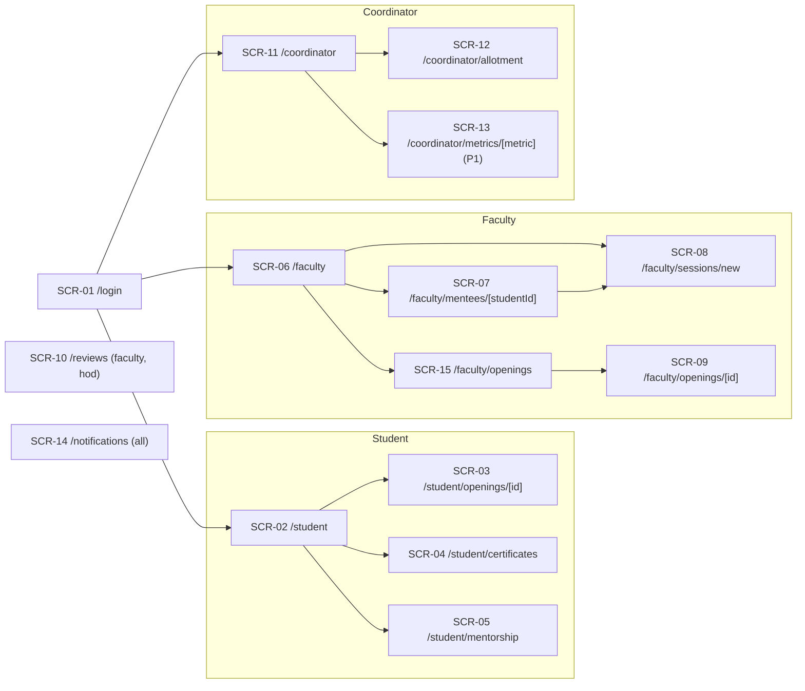

# Frontend and UX: Flows, Screens and Components
Purpose:      Define every screen, flow, state, copy line and component that CMP-01 renders, mapped to REQ- and API- IDs.
Audience:     P3 (student + mentor screens), P4 (coordinator screens), coding agents.
Depends on:   docs/01-product/prd.md, docs/02-architecture/architecture.md, docs/04-backend/backend.md, docs/04-backend/openapi.yaml
Inputs used:  REQ-001..038, NFR-03, 05, 06; a new Next.js 14 + Tailwind frontend scaffolded at hour 0
Status:       Draft v1 | assumptions in this document: A-03, A-20

Screens and components (§6, §7) and client state (§8) are sections of this document.

## 1. Principles for this UI

- Verified versus claimed is always visible: every skill chip carries its trust badge (REQ-003, REQ-004).
- Every DRAFT, simulated or seeded value is labelled: a "DRAFT" tag on exports, and "Sample data" on academics `[MOCK]`.
- The mentor's next action is one tap from the home screen: "Log session" and "Open" on every mentee row.
- No page renders data it did not get from the API. Hiding fields is never the privacy control; the server is (security §4).

### 1.1 Visual style (carried over from the earlier GuruSetu UI)

The look matches the earlier GuruSetu prototype, so the product is recognisable. Tokens live in `frontend/tailwind.config.ts`; shared classes in `src/app/globals.css`. Every screen owner (P1, P3, P4) uses these, not ad-hoc colours.

| Element | Rule | Token / class |
|---|---|---|
| Primary colour | Maroon `#8C1515` for headers, primary buttons, section titles, active nav; hover `#7A1212`, pressed `#6B1010` | `brand`, `brand-hover`, `brand-active` |
| Accent | Gold `#D4AF37` for match/score badges and highlights, **as a fill only**, with `gold-ink` text on it (gold text on white fails contrast) | `gold`, `gold-soft`, `gold-ink` |
| Canvas | Light grey page background `#F2F2F2`; content sits on white cards | `bg-canvas` |
| Page header | Maroon band, white text, name/greeting in black weight; sticky on mobile | `AppShell` |
| Cards | White, `rounded-card` (1.5rem), thin `gray-100` border, `shadow-sm`, padding 20 px | `.card` |
| Section titles | Maroon, `font-black`, uppercase, `tracking-widest`, small size | `.section-title` |
| Buttons | Primary: maroon pill (`rounded-2xl`), white uppercase black-weight label; secondary: maroon outline | `.btn-primary`, `.btn-secondary` |
| Toggles | Segmented pill (grey track, maroon active segment), e.g. the role switch on login | `components/ui` |
| Pills and chips | `rounded-full`, small bold text; status is always written as text | `StatusPill`, `SkillChip` |
| Body text | `gray-900` / `gray-600`; never `gray-400` for text (contrast, NFR-05) | — |
| Icons | `lucide-react` (bundled, offline), always with a text label or `aria-label` | — |

Avatars use initials, not an external avatar service (offline demo, no external assets).

## 2. Information architecture



**Navigation per role:**
- Desktop uses a left sidebar; at < 768 px it becomes a bottom bar with 4 items plus "More".

| Role | Items |
|---|---|
| student | Home (SCR-02), Certificates (SCR-04), My mentorship (SCR-05), Notifications (SCR-14) |
| faculty | My mentees (SCR-06), My openings (SCR-15), Reviews (SCR-10), Notifications (SCR-14) |
| hod | Dashboard (SCR-11), Allotment (SCR-12), Reviews (SCR-10), Notifications (SCR-14) |
| iqac | Dashboard (SCR-11), Notifications (SCR-14) |

The header shows the user's name, role label, a notification bell with the unread count (API-037), and "Log out". Log out clears localStorage and goes to `/login`.

## 3. Flows

Each step is: user action → system response → screen. The failure branches are listed under each flow.

**FLOW-01 Login (REQ-031)**
1. The user enters email and password and presses "Log in" → API-001 → stores `token`, `role`, `user_id` → routes by role: student `/student`, faculty `/faculty`, hod/iqac `/coordinator`.
- Failure: 401 → inline error "Email or password is incorrect." with focus on the password field. 429 → "Too many attempts. Try again in a minute."
- Any later API 401 → clear the token → `/login?expired=1` → banner "Session expired, please log in again."

**FLOW-02 Verify a certificate (REQ-001, 002, 003, 037)**
1. SCR-04 → "Upload certificate" → file picker (accept `.jpg,.jpeg,.png,.pdf`), with a client-side check of ≤ 10 MB.
2. API-005 → a row appears with "Reading certificate…" and a spinner → poll API-006 every 2 s (max 30 s).
3. The terminal status renders as a card:
   - `certified`: a green badge "Verified", the extracted fields, skill chips, and the toast "PyTorch is now Certified".
   - `needs_review`: an amber badge "Waiting for review", plus a reason line per reason code (§4.2).
   - `duplicate`: a grey badge "Already uploaded" and the copy "This matches a certificate already on GuruSetu."
   - `failed`: a red badge "Couldn't read automatically" and the button "Enter details" → manual form (fields from `ManualCertificate`) → API-008 → `needs_review`.
- Failure: 413 → "File is larger than 10 MB." 415 → "Upload a JPG, PNG or PDF." Polling still `processing` after 30 s → "Still working. We'll notify you." and polling stops; the notification arrives later.

**FLOW-03 Fit Check and apply (REQ-004, 006, 020, 021)**
1. SCR-02 lists openings with fit badges → tap one → SCR-03 → API-013 + API-015.
2. Shown: a score ring (0–100), the verdict text, a 3-segment breakdown bar (semantic, skill, concept) with values, chips grouped Matched / Claimed only / Near / Missing, and a gains list ("Certify computer vision → 55").
3. A "Prove it" link next to claimed or missing chips → SCR-04.
4. "Apply" → API-017 → the button becomes the "Applied · Pending" pill.
5. (P1) "Why?" → API-020 → a WhyGraph panel.
- Failure: 409 `ALREADY_APPLIED` → pill "Applied" (no error toast). 409 `OPENING_CLOSED` → "This opening is closed."

**FLOW-04 Decide an applicant (REQ-005, 006)**
1. SCR-15 → own opening → SCR-09 → API-016 shows ranked applicant cards.
2. Expanding a card shows that applicant's Fit (the same component as SCR-03, read-only).
3. Actions follow the status: pending → [Shortlist] [Reject]; shortlisted → [Accept] [Reject]; accepted → [Mark completed] → API-018 → the card status updates and a toast shows "Aarav Menon accepted. Guide link created."
- Failure: 409 `INVALID_TRANSITION` → toast "This application changed. Refreshing." → refetch.

**FLOW-05 Review a certificate (REQ-002)**
1. SCR-10 → API-009 shows queue cards: student, the file preview (API-011, rendered in `` or `<iframe sandbox>`), extracted fields, and reasons.
2. "Approve" → API-010 `approve` → the card leaves the queue → toast "Approved".
3. "Reject" → a reason textarea (3–300 chars, required) → API-010 → card removed.
- Failure: 409 `ALREADY_REVIEWED` → card removed with toast "Already reviewed by someone else."

**FLOW-06 Allot mentors (REQ-007)**
1. SCR-12 → API-022 → left: the unallotted list with checkboxes; right: mentor cards showing load "13 / 20".
2. Select students → choose a mentor → "Assign 2 students to Dr. Meera Raman" → API-023 → the lists refresh.
3. To reassign, a student row's "Change mentor" (P2) uses the same call.
- An overloaded mentor shows an amber "Overloaded (21/20)" badge; assignment is still allowed.

**FLOW-07 Log a session (REQ-008, 010, 011; NFR-03 ≤ 120 s)**
1. From SCR-06 "Log session", or SCR-07 "Log session for {name}" (prefilled individual) → SCR-08.
2. The form, top to bottom:
   - date (default today)
   - mode toggle (default In person)
   - kind toggle (default Group from SCR-06, Individual from SCR-07)
   - context (Assigned / Research guide + opening select)
   - attendees list with "Select all mentees" and a present/absent toggle per row (default present)
   - topic chips (multi-select)
   - notes (with the label "Private: only you can see this")
   - action items repeater (student select, text, owner, due date; default due = date + 7 days)
   - issues repeater (student, category, text)
   - next follow-up date
3. "Save session" → API-026 with an `Idempotency-Key` generated when the form opens → back to the originating screen with the toast "Session saved for 12 students".
- Failure: 422 → field errors inline; the first invalid field gets focus. Network error → button "Retry", reusing the same Idempotency-Key.

**FLOW-08 Mentee confirms and acts (REQ-009, 010, 014)**
1. A notification or SCR-05 → "Sessions to confirm" → "Confirm I attended" → API-028 → the row moves to "Recent sessions" with a ✓ Confirmed label.
2. Action items: a checkbox "Mark done" → API-030 `done` → the item moves to "Waiting for mentor".
3. (P1) "Request a meeting" → a dialog with a message → API-045 → toast "Dr. Meera Raman has been notified." (P1) "Raise an issue" → API-031.
- Failure: 409 `NOT_PRESENT` → hide confirm and show "You were marked absent for this session."

**FLOW-09 Mentor follow-up (REQ-012, 013, 011, 022)**
1. SCR-06 → flagged mentees on top with reason badges → "Open" → SCR-07 (API-025).
2. In the Issues section: "Resolve" → a resolution textarea → API-032 → status Resolved.
3. Action items "To verify" → [Verify] [Reopen] [Drop] → API-030.
4. (P1) "Escalate to HOD" with a confirm dialog "The HOD will be able to read this issue." → API-032 `escalated: true`.

**FLOW-10 Coordinator dashboard and export (REQ-016, 017)**
1. SCR-11 → API-033 → KPI tiles, a per-mentor table, an issues-by-category bar chart, achievements by type, and (HOD only) the needs-attention list.
2. "Export mentoring pack" → API-035 → browser download `gurusetu-mentoring-2026-ODD-DRAFT.xlsx`. "Export achievements" → API-036.
3. (P1) Clicking a KPI number → SCR-13 → API-034 table.

**FLOW-11 First run and empty states**
- A student with no certificates: SCR-04 shows the empty state "No certificates yet. Upload one to turn claimed skills into Certified." with the Upload button.
- A student with no assigned mentor: SCR-05 shows "No mentor assigned yet. Your HOD allots mentors."
- Faculty with no mentees: SCR-06 shows "No mentees assigned yet."
- No openings: SCR-02 shows "No open openings right now."
- Coordinator with 0 sessions this term: tiles show 0, and the table shows "No sessions logged this term yet."

## 4. States and copy

### 4.1 State rules for every data view
| State | Rendering |
|---|---|
| Loading | Skeleton blocks shaped like the content; no spinner longer than 300 ms without a skeleton |
| Empty | `EmptyState` with the FLOW-11 copy |
| Populated | As wireframed |
| Error (5xx / network) | `ErrorState`: "Something went wrong. Try again." with a Retry button and `request_id` in small text |
| Not found / out of scope (404) | "This page isn't available." with a link home |
| Forbidden (403) | "You don't have access to this." |
| Partial (one of several calls fails) | Render the sections that loaded; the failed section shows an inline `ErrorState` |
| Offline | Banner "You're offline. Changes will fail until you reconnect." (`navigator.onLine`) |

### 4.2 Reason copy (certificate reasons → student-facing text)
| Code | Text |
|---|---|
| name_mismatch | "The name on the certificate doesn't match your profile name." |
| unknown_issuer | "We don't recognise this issuer yet." |
| date_invalid | "The date looks wrong or is missing." |
| incomplete | "Some details couldn't be read." |
| not_a_certificate | "This doesn't look like a certificate." |
| injection_text | "This file needs a manual check." |
| tamper_signal | "This image may have been edited." |
| manual_entry | "Entered manually." |
| extraction_failed, interrupted | "We couldn't read this file automatically." |
| duplicate_* | "This matches a certificate already on GuruSetu." |

### 4.3 Attention reason labels
`no_recent_session` "Not met in 45+ days" · `no_meeting_this_term` "No meeting this term" · `overdue_action` "Overdue action" · `stale_issue` "Issue open 14+ days" · `marked_at_risk` "Marked at risk" · `suggested_at_risk` "Suggested at risk: {detail}".

The day numbers come from the API config values, not hard-coded strings. `GET /me` does not return them, so the copy uses the defaults (A-20).

### 4.4 Formats
- Dates: `10 Oct 2026`.
- Relative dates: "3 days ago" (when ≤ 14 days), else the absolute date.
- Scores: one decimal.
- Percentages: one decimal with `%`.
- Ratio: as returned (`1:12`).
- Tone: plain, second person, no exclamation marks.

## 5. Accessibility and responsive rules

- WCAG 2.2 AA contrast on all text and badges. Trust badges carry text ("Certified"), never colour alone.
- The keyboard path through FLOW-02, 03, 07 and 08 works with Tab, Enter and Space only. Dialogs trap focus and return it to the trigger. The first invalid field receives focus on a 422.
- All inputs have visible labels. Icon buttons have an `aria-label`. Toasts use `role="status"`. Errors use `role="alert"`.
- Touch targets are ≥ 44 × 44 px. `prefers-reduced-motion` disables the score-ring animation.
- **Breakpoints:**
  - < 768 px: single column, bottom nav, tables become stacked cards.
  - 768–1279 px: sidebar collapsed to icons.
  - ≥ 1280 px: full sidebar and two-column layouts (SCR-03, SCR-07).
- Lighthouse accessibility ≥ 90 on every P0 screen (NFR-05).

## 6. Screens

| ID | Route | Roles | Purpose | REQ | API | Tier |
|---|---|---|---|---|---|---|
| SCR-01 | /login | public | Log in | 031 | 001, 002 | P0 |
| SCR-02 | /student | student | Openings with fit; mentorship summary; (P1) skill-gap panel | 004, 014, 021 | 012, 029, 021 | P0 |
| SCR-03 | /student/openings/[id] | student | Fit Check, apply, (P1) Why graph | 004, 006, 020 | 013, 015, 017, 020 | P0 |
| SCR-04 | /student/certificates | student | Upload, statuses, manual entry, skills with trust | 001, 002, 003, 037 | 005–008, 003, 004 | P0 |
| SCR-05 | /student/mentorship | student | Mentor, guides, sessions to confirm, actions, issues, applications | 009, 010, 014, 024, 034 | 029, 028, 030, 031, 045, 042 | P0 |
| SCR-06 | /faculty | faculty | My mentees with flags | 012 | 024 | P0 |
| SCR-07 | /faculty/mentees/[studentId] | faculty, hod | Mentee 360 | 013, 011, 022, 027, 032, 033, 036 | 025, 032, 030, 041, 043 | P0 |
| SCR-08 | /faculty/sessions/new | faculty | Log a session | 008, 010, 011 | 024 (attendee list), 026 | P0 |
| SCR-09 | /faculty/openings/[id] | faculty | Ranked applicants and decisions | 005, 006 | 013, 016, 015, 018 | P0 |
| SCR-10 | /reviews | faculty, hod | Certificate review queue | 002 | 009, 010, 011 | P0 |
| SCR-11 | /coordinator | hod, iqac | Dashboard and exports | 016, 017 | 033, 035, 036 | P0 |
| SCR-12 | /coordinator/allotment | hod | Allot mentors | 007, 028 | 022, 023 | P0 |
| SCR-13 | /coordinator/metrics/[metric] | hod, iqac | Click-to-source records | 019 | 034 | P1 |
| SCR-14 | /notifications | all | Notifications and (P1) reminders | 038, 023 | 037, 038, 039 | P0 |
| SCR-15 | /faculty/openings | faculty | Own openings list; (P1) create form | 005, 030 | 012, 014 | P0 (list), P1 (create) |
| SCR-16 | /faculty-profile/[id] | student | Faculty track record | 035 | 044 | P2 |

**Form validation (messages are shown exactly):**
- **SCR-01:** email required ("Enter your email."), password required ("Enter your password.").
- **SCR-04 manual form:** every field required ("This field is required."); `issue_date` not in the future ("Date cannot be in the future."); 1–8 skills ("Add at least one skill.").
- **SCR-08:**
  - date ≤ today ("Session date cannot be in the future.");
  - ≥ 1 attendee ("Select at least one student.");
  - individual means exactly 1 attendee ("An individual session has one student.");
  - ≥ 1 topic ("Pick at least one topic.");
  - action text 1–300 ("Keep action items under 300 characters.");
  - due date ≥ session date ("Due date must be on or after the session date.");
  - follow-up after the date ("Follow-up must be after the session date.").
- **SCR-10 reject:** reason 3–300 ("Give a reason (at least 3 characters).").
- **SCR-15 create (P1):** title 5–120, description ≤ 2000, 1–10 skills.

### 6.1 Wireframes (P0)

```
SCR-02 /student                                SCR-03 /student/openings/[id]
┌───────────────────────────────────────┐      ┌───────────────────────────────────────────────┐
│ My mentor: Dr. Meera · 1 to confirm ▸ │      │ Edge AI for Agriculture · Dr. Meera Raman      │
├───────────────────────────────────────┤      │ ┌───────┐  Close: certify the skills below…    │
│ Openings                               │      │ │ 43.4  │  [semantic 17.5|skill 24.8|concept 1.1]│
│ ┌───────────────────────────────────┐ │      │ └───────┘                                       │
│ │ Edge AI for Agriculture   43 Close│ │      │ Matched:  [python ✔Certified]                  │
│ │ Dr. Meera · python pytorch …      │ │      │ Claimed:  [pytorch ○Claimed] Prove it ▸        │
│ └───────────────────────────────────┘ │      │ Near:     [computer vision ~ via deep learning]│
│ ┌───────────────────────────────────┐ │      │ Missing:  —                                     │
│ │ NLP for Malayalam OCR  71 Ready   │ │      │ Certify computer vision → 55.0                  │
│ └───────────────────────────────────┘ │      │ [ Apply ]   [ Why? ] (P1)                       │
│ (P1) Learn docker → unlocks 2         │      └───────────────────────────────────────────────┘
└───────────────────────────────────────┘

SCR-04 /student/certificates                   SCR-05 /student/mentorship
┌───────────────────────────────────────┐      ┌───────────────────────────────────────┐
│ [ Upload certificate ]                │      │ Assigned mentor: Dr. Meera Raman       │
│ ● Deep Learning with PyTorch  Verified│      │ Guides: — · Next follow-up: 24 Oct     │
│   NPTEL · 15 Apr 2026 · conf 1.00     │      │ Sessions to confirm                    │
│   [deep learning ✔][pytorch ✔]        │      │  10 Oct · group · [Confirm I attended] │
│ ● Embedded C          Waiting review  │      │ Action items                           │
│   Name doesn't match your profile.    │      │  ☐ Finish DL assignment 3 · due 17 Oct │
│ ● Python (copy)       Already uploaded│      │ Issues · Applications (status pills)   │
│ My skills: python ✔ pytorch ✔ …       │      │ (P1) [Request a meeting] [Raise issue] │
└───────────────────────────────────────┘      └───────────────────────────────────────┘

SCR-06 /faculty                                 SCR-07 /faculty/mentees/[id]
┌──────────────────────────────────────────────┐ ┌──────────────────────────────────────────────┐
│ My mentees (13)        [ Log session ]        │ │ Karthik S · CB.EN.U4CSE24017 · Year 2        │
│ ⚠ Karthik S  2/2  last 11 Aug  ⏰1 overdue  [Open]│ │ ⚠ Not met in 45+ days · Overdue action      │
│   Not met in 45+ days · Overdue action        │ │ Skills [..trust chips..]   Academics (Sample)│
│ ⚠ Diya R     2/2  issue open 16 days     [Open]│ │ Timeline: sessions / actions / issues        │
│ ⚠ Rahul P    2/2  ⏰1 overdue             [Open]│ │ Action items: To verify [Verify][Reopen]     │
│   Aarav M    3/2  last 10 Oct            [Open]│ │ Issues: attendance · raised 2 Sep [Resolve]  │
│ Guided students (1)                           │ │ Applications · Certificates                   │
└──────────────────────────────────────────────┘ │ [ Log session for Karthik ]                   │
                                                 └──────────────────────────────────────────────┘
SCR-08 /faculty/sessions/new                    SCR-09 /faculty/openings/[id]
┌──────────────────────────────────────────────┐ ┌──────────────────────────────────────────────┐
│ Date [10 Oct 2026]  (●In person ○Online)      │ │ Edge AI for Agriculture · 4 applicants        │
│ (●Group ○Individual)  Context [Assigned ▾]    │ │ 1 Aarav Menon   68.5 Ready  pending           │
│ Attendees [Select all]                        │ │   [python✔][pytorch✔][dl✔][cv✔]  [Shortlist][Reject]│
│  ☑ Aarav M  (●Present ○Absent) … ×13          │ │ 2 Priya K      52.0 Close  pending  …         │
│ Topics [academic][attendance][career]…        │ └──────────────────────────────────────────────┘
│ Notes (Private: only you can see this) [   ]  │
│ Action items [+]  Issues [+]  Follow-up [ ]   │ SCR-10 /reviews
│                      [ Save session ]         │ ┌──────────────────────────────────────────────┐
└──────────────────────────────────────────────┘ │ Aarav Menon · Embedded C · Name doesn't match │
                                                 │ [file preview]  fields…   [Approve] [Reject]  │
SCR-11 /coordinator                              └──────────────────────────────────────────────┘
┌──────────────────────────────────────────────┐
│ DRAFT evidence · Odd semester 2026            │ SCR-12 /coordinator/allotment
│ [48/50 allotted][1:12][Compliance 91.7%]      │ ┌──────────────────────────────────────────────┐
│ [Issues 11/13 resolved][8 overdue][1 review]  │ │ Unallotted (2)        │ Dr. Meera   13/20     │
│ Mentor table: meetings · compliant · issues   │ │ ☐ Neha V  ☐ Arun T    │ Dr. Arjun   13/20     │
│ Issues by category (bars)  Achievements       │ │ Assign selected to [Dr. Meera ▾] [Assign]    │
│ (HOD) Needs attention list                    │ └──────────────────────────────────────────────┘
│ [Export mentoring pack] [Export achievements] │
└──────────────────────────────────────────────┘ SCR-14 /notifications: list, unread bold, [Mark read]
SCR-15 /faculty/openings: list of own openings with applicant counts; (P1) [New opening] form.
```

## 7. Components

Custom components use Tailwind. There is no component library (small custom UI kit in `components/ui`), plus `recharts` and (P1) `react-force-graph-2d` (architecture §4).

| Component | Props | Variants / states | Events | A11y |
|---|---|---|---|---|
| AppShell | role, user | sidebar / bottom-nav | logout | `<nav aria-label="Main">` |
| AuthGuard | allowedRoles | — | redirect | — |
| NotificationBell | unread | 0 / n | open | `aria-label="Notifications, {n} unread"` |
| TrustBadge | level 0–2 | Claimed (outline) / Certified (green ✔) / Faculty-verified (blue ★) | — | Text label always present |
| SkillChip | concept, kind, trust_level, via?, source? | matched / claimed_only / near / missing | onProve | Chip text includes kind |
| FitScoreRing | score, verdict | ready / close / not_yet | — | `role="img" aria-label="Fit 43.4 of 100, Close"` |
| ScoreBreakdownBar | components, weights | — | — | Values also as text |
| CertificateUploader | onUploaded | idle / uploading / error | upload | Native file input with label |
| CertificateCard | certificate | per status | onManual | Status text, not colour only |
| ManualCertificateForm | certificate | — | submit | Labelled fields |
| ReviewCard | item | — | approve, reject | Reject dialog focus trap |
| MenteeRow | row | flagged / normal | open, logSession | Reason badges as text |
| AttentionBadge | reason | per reason | — | Text |
| SessionForm | prefill | — | submit | Fieldsets with legends |
| AttendeePicker | mentees, value | select all | change | Checkbox + radio group per row |
| TopicChips | value | — | change | `role="group"`, toggle buttons with `aria-pressed` |
| ActionItemEditor / ActionItemList | items, role | open / overdue / done / verified / dropped | statusChange | Overdue as text |
| IssueList | issues, role | per status; text hidden when absent | resolve, escalate | — |
| Timeline | events | — | — | `<ol>` |
| KpiTile | label, value, metric? | clickable (P1) | drill | Link when clickable |
| MentorTable | mentors | overloaded row | — | `<table>` with `<th scope>` |
| StatusPill | status | per enum | — | Text |
| EmptyState / ErrorState / Skeleton | copy / requestId | — | retry | `role="alert"` on error |
| ExportButton | href, filename | loading | download | — |
| WhyGraph (P1) | graph | — | — | Also rendered as a text list of paths for screen readers |

## 8. Client state and API usage

- **One axios instance** in `src/lib/api.ts`:
  - `baseURL = NEXT_PUBLIC_API_BASE`;
  - adds `Authorization` from localStorage;
  - on 401 it clears storage and routes to `/login?expired=1`;
  - it parses `application/problem+json` into `{code, detail, errors}`.
- **Types** are generated from `openapi.yaml` into `src/lib/types.ts` (`npx openapi-typescript docs/04-backend/openapi.yaml -o frontend/src/lib/types.ts`).
- **Data fetching:**
  - each page uses a small `useApi(path)` hook (`data`, `error`, `loading`, `reload`);
  - there is no global store, and the server is the source of truth;
  - after any mutation the page calls `reload()`, so there are no optimistic updates. The exception is the action-item checkbox: optimistic, rolled back on error with the toast "Couldn't update. Try again."
- **Polling:** API-006 every 2 s for up to 30 s (FLOW-02); API-037 unread count every 30 s while the tab is visible.
- **Downloads:** XLSX is fetched with `responseType: 'blob'` and saved with the filename from `Content-Disposition`.
- All user-supplied text renders as React text, never with `dangerouslySetInnerHTML` (SEC-19).

## Verify

1. Seed, then log in as each role (`aarav@`, `meera@`, `suresh@`, `kavya@demo.gurusetu`, password `Demo@123`). Each lands on its home screen, and the nav shows exactly the items in §2.
2. Open every P0 SCR- route: each renders with seed data, and a forced API error (stop the backend) shows `ErrorState` rather than a blank page.
3. Using only the keyboard, complete FLOW-07 for 12 attendees with 2 action items and time it (≤ 120 s, NFR-03).
4. Run a Lighthouse accessibility audit on SCR-02, 03, 06, 08 and 11: each scores ≥ 90.
5. At 360 px width (Chrome device toolbar), SCR-05 and SCR-06 have no horizontal scroll.
