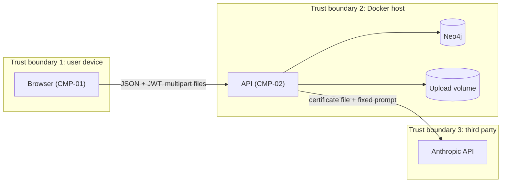

# Security and Privacy
Purpose:      Define authentication, the access and visibility rules, testable security requirements and the threat model, so the audit's critical holes stay closed and mentoring data stays private.
Audience:     P2 (enforcement in deps and services), P3/P4 (frontend rules), reviewers.
Depends on:   docs/01-product/prd.md, docs/02-architecture/architecture.md, docs/04-backend/backend.md, docs/06-ai/ai-system.md
Inputs used:  Audit §5 (C1–C3, H5–H7, M6, M7), REQ-015, REQ-036, NG-01..03, ADR-03, ADR-09, ADR-13
Status:       Draft v1 | assumptions in this document: A-04, A-21

The threat model (§10) and compliance notes (§11) are sections of this document.

## 1. Assets and data classification

| Class | Data | Stored in | Readable by |
|---|---|---|---|
| Secret | `password_hash`, `JWT_SECRET_KEY`, `NEO4J_PASSWORD`, `ANTHROPIC_API_KEY` | Neo4j (hash only); `.env` | The API process only |
| Sensitive personal | Session notes, issue text, action item text, confidential flags, learner level and note, at-risk mark, academic snapshot `[MOCK]` | Neo4j | Per §4 |
| Personal | Name, email, roll number, certificates (files and fields), skills, applications | Neo4j, upload volume | Per §4 |
| Internal | Embeddings, StatusEvents, notifications | Neo4j | The API (embeddings are never returned) |
| Aggregate | Dashboard counts, export summaries | Computed | HOD, IQAC |

All data in this build is synthetic (SEC-14). This classification also governs any future real deployment.

## 2. Authentication

- **Method:** seeded email and password (NG-01). Hashing uses `bcrypt` directly with cost 12 (A-21); passwords longer than 72 bytes are rejected at login and in the seed (bcrypt's limit).
- **Token:** JWT HS256 with claims `{sub: user_id, role, exp, iat}`; lifetime `JWT_EXPIRE_MINUTES` (480).
- **Verification:** signature and `exp` are checked on every request. The user is re-read from Neo4j by `sub`, and the `role` comes from the database, not the token. A token whose user no longer exists returns 401.
- No refresh tokens. No password reset or recovery (NG-02). No MFA, because the seeded demo accounts carry synthetic data only.
- **Storage:** the frontend keeps the token in localStorage (ADR-09). The residual risk is in §9.

## 3. Authorization: role × route

Roles per route are in [backend.md §4](../04-backend/backend.md) (the Roles column). The rules:
- Role checks run in `require_role(...)` deps.
- A role not listed for a route → 403 `FORBIDDEN`.
- A listed role acting on a resource outside its scope (§4) → 404 `NOT_FOUND`, so existence never leaks.

## 4. Scope and field visibility (home of these rules)

**Scope predicates**, evaluated in Cypher inside the same query that reads the data:

| Predicate | Definition |
|---|---|
| `self(U, S)` | U.user_id = S.user_id |
| `mentor_of(F, S)` | Active `MENTORS` F→S of any type |
| `assigned_mentor_of(F, S)` | Active `MENTORS {type:'assigned'}` F→S |
| `author_of(F, X)` | F `LOGGED` the session X (or the session that created item X) |
| `owner_of(F, O)` | F `POSTED` opening O |
| `applicant_of_own(F, S)` | S `APPLIED_TO` O and `owner_of(F, O)` |
| `dept_of(U, S)` | U.dept_code = S.dept_code and U.role = hod |
| `escalated(I)` | Issue I has `escalated = true` |

**Field visibility.** ✔ = full, ◐ = partial as described, ✘ = not returned:

| Data | Student (self) | Mentor / guide of student | Faculty with student as applicant | HOD (same dept) | IQAC |
|---|---|---|---|---|---|
| Session notes | ✘ | ✔ only if `author_of`; otherwise ✘ (includes a new mentor after handover, REQ-028) | ✘ | ✘ | ✘ |
| Session date, mode, topics | ✔ (own attendee row only; other attendees hidden) | ✔ | ✘ | counts only | counts only |
| Action items | ✔ own | ✔ items from own sessions; read-only for others' sessions | ✘ | counts | ✘ |
| Issue text | ✔ issues about self, unless the mentor raised it `confidential` | ✔ if mentor_of; ✘ if confidential and not raised by them | ✘ | ✔ only when `escalated` and not confidential | ✘ |
| Issue category + status | ✔ own | ✔ | ✘ | ✔ (confidential ones counted as "confidential", category hidden) | aggregates |
| Academic snapshot | ✔ | ✔ | ✘ | ✔ | ✘ |
| Learner level / note, at-risk (P2) | ✘ | ✔ assigned mentor only | ✘ | level ✔, note ✘ | MET-11 count only |
| Skills, certified certificates | ✔ | ✔ | ✔ | ✔ | export list (names allowed: institutional achievement record) |
| `needs_review` / `rejected` / `duplicate` certificates | ✔ own (no `duplicate_of`) | ✔ assigned mentor (with `duplicate_of`) | ✘ | ✔ (with `duplicate_of`) | ✘ |
| Applications | ✔ own | ✔ (Mentee 360) | ✔ for own openings | ✔ | ✘ |
| Session feedback (P2) | ✔ own | ✔ author only | ✘ | ✘ | ✘ |
| Dashboard / drill-down | ✘ | ✘ | ✘ | ✔ with names | ✔ with pseudonyms |
| Exports | ✘ | ✘ | ✘ | ✔ | ✔ |

Implementation rule: response models declare the optional fields (`notes`, `text`, `duplicate_of`, `learner_note`). Services set them to absent (field omitted) when the predicate fails. The server never sends a field and relies on the UI to hide it.

## 5. Security requirements

| ID | Requirement | Addresses | Test |
|---|---|---|---|
| SEC-01 | No response body contains `password_hash`, `embedding` or `file_path`; every route has an explicit Pydantic response model | Audit C1 | TEST-01 |
| SEC-02 | `/auth/register`, `/auth/verify-identity`, `/auth/reset-password`, `/users/upload-profile-picture` and all old `/dashboard/*` and `/recommend/*` paths return 404 | Audit C2, H7, ADR-03 | TEST-02 |
| SEC-03 | Every route except API-001 and API-040 returns 401 for a missing, malformed, tampered or expired token | THR-01 | TEST-03, TEST-11 |
| SEC-04 | A role not listed for a route gets 403 | Audit C3, THR-04 | TEST-04 |
| SEC-05 | Out-of-scope resources return 404 under §4 predicates (other faculty's opening candidates, another mentor's mentee, another student's certificate, file or session) | Audit C3, THR-05 | TEST-05 |
| SEC-06 | Uploads: • authenticated; • byte count enforced while streaming (> `MAX_UPLOAD_MB` → 413); • type from magic bytes (`FF D8 FF`, `89 50 4E 47 0D 0A 1A 0A`, `25 50 44 46 2D`, else 415); • PDF ≤ 5 pages; • stored as `<uuid>.<ext>` under `UPLOAD_DIR`, outside any static mount; • served only by API-011 with `X-Content-Type-Options: nosniff` and `Content-Disposition: inline`; • images re-encoded by Pillow before any further processing; • the old `/uploads` static mount removed. | Audit H7, THR-06 | TEST-06, TEST-12 |
| SEC-07 | Session notes appear only in responses to their author (REQ-015) | RISK-05, THR-07 | TEST-20 |
| SEC-08 | Confidential sessions and issues are filtered per §4 and counted only as "confidential" (REQ-036) | THR-07 | TEST-26 |
| SEC-09 | LLM controls per ai-system §6: the document is data, structured output only, no tools, and the model cannot set status, trust or confidence | THR-09 | EVAL-04 |
| SEC-10 | Secrets live only in `.env` (gitignored). The app refuses to start if `JWT_SECRET_KEY` < 32 chars or `NEO4J_PASSWORD` < 12 chars. `gitleaks detect` reports 0 findings before the demo. | THR-10 | TEST-10 |
| SEC-11 | Rate limits: API-001 10/min/IP; API-005 20/hour/user; exceeded → 429 with `Retry-After` | THR-02, THR-11 | TEST-09 |
| SEC-12 | CORS allows only `CORS_ORIGINS`; a preflight from another origin gets no `Access-Control-Allow-Origin` | THR-03 | TEST-10 |
| SEC-13 | Every status change writes a StatusEvent (REQ-018); 401/403/404-on-scoped-route/429 are logged at WARNING with user_id and route | Repudiation, THR-12 | TEST-34 |
| SEC-14 | Synthetic data only. `uploads/` is gitignored and holds only synthetic files; no import from the earlier database. | Audit M7, NG-03 | `git ls-files uploads` is empty |
| SEC-15 | Never logged: passwords, tokens, the `Authorization` header, session notes, issue/action/resolution text, file bytes or base64, extracted holder names, API keys | THR-08 | TEST-21 (log grep) |
| SEC-16 | `pip-audit` and `npm audit --audit-level=high` report no high or critical findings, or each one is listed with a reason in §9 | Supply chain | CI / manual run |
| SEC-17 | Cypher uses parameters only. No query string is built from user input (no f-strings or `%`/`+` into `run()`). | Injection, THR-05 | TEST-07 + grep |
| SEC-18 | XLSX cells whose string value starts with `=`, `+`, `-` or `@` are prefixed with `'` | THR-13 | TEST-08 |
| SEC-19 | The frontend never uses `dangerouslySetInnerHTML`. PDF previews render in `<iframe sandbox>`. Images use `` from API-011 only. | THR-14 | grep check |
| SEC-20 | bcrypt cost 12; login compares against a dummy hash when the email is unknown (equal timing); the same error for unknown email and wrong password | THR-02 | TEST-11 |
| SEC-21 | API responses carry `X-Content-Type-Options: nosniff`, `Referrer-Policy: no-referrer` and `X-Frame-Options: DENY` | THR-14 | TEST-10 |

## 6. Input and output handling

- Validation happens at the boundary with Pydantic models generated from or mirroring `openapi.yaml`. They use `additionalProperties: false`, length limits on every string, and enum checks on every status (fixing audit M3).
- Text is stored as given and rendered as text (SEC-19). No HTML is accepted anywhere.
- The only outbound call is to the Anthropic API host. There are no URL fetches from user input, so there is no SSRF surface. `verify_url` is stored and displayed as text only (NG-14).

## 7. Secrets and transport

- `.env` sits at the repo root and is gitignored; `docs/10-devops/env.example` lists the variable names only. No secrets are baked into images.
- Transport: the demo runs on localhost over HTTP (ENV-01/02). Any hosted deployment (ENV-03) must terminate TLS at the platform edge, and must not be used with real data in this build.
- At rest: Neo4j data and uploads are on local Docker volumes; disk encryption is the laptop's (A-21).

## 8. Privacy

| Data | Purpose | Minimisation | Retention |
|---|---|---|---|
| Name, email, roll number | Identity, allotment, evidence | No phone, address or photo collected (the profile-photo upload is deleted) | Until `seed --reset` |
| Certificates | Verify skills; achievements evidence | Only page 1 of a PDF is processed; only the file goes to the LLM | Same |
| Session notes, issues, actions | Mentoring continuity | Private by default; excluded from all exports | Same |
| Academic snapshot `[MOCK]` | At-risk support | Synthetic | Same |

**For a real deployment (not this build):**
- purpose-bound consent recorded per use (verification, evidence export);
- data export and deletion on request;
- a data processing agreement with the LLM provider;
- a counsellor pathway for confidential issues.

These are listed in §11 and on the roadmap slide.

## 9. Accepted residual risks

| Risk | Why accepted | Condition to revisit |
|---|---|---|
| JWT in localStorage is exposed to XSS (ADR-09) | No HTML rendering of user input (SEC-19); synthetic data; 15 h budget | Before any real data: move to httpOnly cookie + CSRF token |
| No MFA, no password recovery | Seeded demo accounts only | Real users: SSO (NG-07) |
| HTTP on localhost | Demo laptop only | Any hosted use: TLS |
| BackgroundTasks lose work on restart (ADR-04) | JOB-02 marks such certificates `failed`; manual entry recovers | Real load: a queue |
| pHash duplicate scan is O(n) over all certificates | ≤ 1,000 seed certificates | > 10k certificates: BK-tree or LSH |
| `npm audit` reports 12 findings in the frontend toolchain (1 critical, 9 high, 2 moderate on 2026-10-10): `next` 14.x (DoS through the Image Optimizer and request deserialization in self-hosted apps), `eslint-config-next` and `tailwindcss` (transitive `chokidar`, `fast-glob`). Every fix is a major upgrade (Next 16, Tailwind 4) | The stack is fixed to Next 14 (A-01). The app never uses `next/image`, so the Image Optimizer is not reachable; the stack binds to `127.0.0.1`. Since T5.P3.2 the runtime image ships only Next's standalone server and its traced dependencies (1.11 GB to 225 MB), so the dev-only findings are not in it; `npm audit --omit=dev` leaves 2 (`next` critical, its bundled `postcss` high), both covered by the reason above. `pip-audit` on the backend: no known vulnerabilities | Any hosted use: upgrade to a patched Next major and re-run `npm audit` |

## 10. Threat model

| ID | STRIDE | Boundary | Threat | Likelihood | Impact | Control |
|---|---|---|---|---|---|---|
| THR-01 | Spoofing | 1→2 | Forged or expired JWT | M | H | SEC-03, SEC-20 |
| THR-02 | Spoofing | 1→2 | Password guessing on seeded accounts | M | M | SEC-11, SEC-20 |
| THR-03 | Spoofing | 1→2 | Malicious site calls the API with a stolen token | L | M | SEC-12 |
| THR-04 | Elevation | 1→2 | Student calls faculty or HOD routes (audit C3) | H | H | SEC-04 |
| THR-05 | Info disclosure | 1→2 | IDOR on applicants, mentees, certificates, sessions; Cypher injection | H | H | SEC-05, SEC-17 |
| THR-06 | Tampering / DoS | 1→2 | Oversized or polyglot upload; stored file served as HTML | M | H | SEC-06 |
| THR-07 | Info disclosure | 2→1 | Session notes or confidential issue text leak via an endpoint or export | M | H | SEC-07, SEC-08, REQ-015 |
| THR-08 | Info disclosure | 2 | Sensitive text in logs | M | M | SEC-15 |
| THR-09 | Tampering | 2→3 | Prompt injection in a certificate tries to certify a skill | M | M | SEC-09, ADR-07 |
| THR-10 | Info disclosure | repo | Secrets committed | M | H | SEC-10 |
| THR-11 | DoS / cost | 2→3 | Upload spam drives LLM cost | L | M | SEC-11, `MAX_LLM_CALLS_PER_DAY` |
| THR-12 | Repudiation | 2 | A mentor denies changing an issue or application | L | M | SEC-13 |
| THR-13 | Tampering | export | Formula injection in XLSX opened by IQAC | L | M | SEC-18 |
| THR-14 | Tampering | 2→1 | XSS via stored text or file preview | L | H | SEC-19, SEC-21 |

## 11. Compliance notes

- **DPDP Act 2023 (India)** would apply to a real deployment that processes student personal data [VERIFY: DPDP Act 2023 and the DPDP Rules as notified]. It does not apply to this synthetic-data build (NG-03).
- Obligations that would touch the software, and their hooks in this design:
  - notice and consent per purpose: roadmap consent ledger;
  - purpose limitation: §8 table;
  - reasonable security safeguards: SEC-01..21;
  - data principal rights to access, correction and erasure: roadmap;
  - breach notification: roadmap.
- **Accreditation:** export criterion codes are drafts (ENT-13) and must be checked against the official NAAC manual before any use [VERIFY].

## Verify

1. Run `docker compose exec backend pytest -q tests/test_security.py`: TEST-01..12 pass.
2. As Aarav, run `curl -H "Authorization: Bearer $AARAV" localhost:8000/api/v1/openings/op-edge-ai/candidates` → 403. As Dr. Arjun → 404. As Dr. Meera → 200.
3. As the HOD, `GET /api/v1/sessions/{a session id}` → 403. As Dr. Arjun → 404. As Aarav (attendee) → 200 with no `notes` key.
4. Run `curl -X POST localhost:8000/auth/reset-password` → 404, and `grep -rn "dangerouslySetInnerHTML" frontend/src` → no output.
