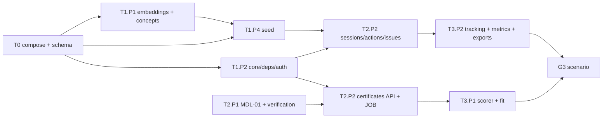

# Phase Plan: 15-Hour Build
Purpose:      Turn the spec pack into an hour-by-hour, person-by-person build plan with tasks, dependencies and hard gates.
Audience:     The 4 builders (P1–P4) and coding agents working on a task.
Depends on:   docs/00-index.md and the whole spec pack; docs/plan/prd-v2-and-15h-plan.md §13 (team plan)
Status:       Draft v1. This refines team plan §13.2–13.3. Where hours differ, this folder wins; where a spec fact differs, the spec pack wins.

---

## 1. Phases at a glance

| Phase | Hours | Doc | Goal | Exit gate |
|---|---|---|---|---|
| 0 | 0:00–1:00 | [phase-0-setup.md](phase-0-setup.md) | Decisions made, repo boots for everyone | G0: compose healthy, health 200, frontend builds, decisions logged |
| 1 | 1:00–4:00 | [phase-1-foundation.md](phase-1-foundation.md) | Old code secured and rewired under `/api/v1`; seed loads; login works for 4 roles | G1: security tests green, seed loads, role routing works |
| 2 | 4:00–7:00 | [phase-2-core-verify-mentor.md](phase-2-core-verify-mentor.md) | Certificate pipeline end to end; allotment, sessions, action items, issues | G2 (midpoint, 7:00): upload → Certified works; a session saves and lists |
| 3 | 7:00–10:00 | [phase-3-core-match-track-evidence.md](phase-3-core-match-track-evidence.md) | Fit Check, candidates, mentor home, Mentee 360, mentorship page, dashboard, exports | **G3 CORE FREEZE (10:00)**: index §7 scenario passes twice; P0 tests green |
| 4 | 10:00–12:30 | [phase-4-addon-a.md](phase-4-addon-a.md) | ADD-ON A (P1 requirements) in priority order | Each item merges only with the scenario still green |
| 5 | (stretch, inside 10:00–12:00) | [phase-5-addon-b.md](phase-5-addon-b.md) | ADD-ON B (P2 requirements), only by someone whose A items are merged | Same per-item rule; expected to be mostly roadmap |
| — | all | [parallel-work.md](parallel-work.md) | File ownership, seams and git workflow for conflict-free parallel work | `check_ownership.py` passes on every push |
| 6 | 12:30–15:00 | [phase-6-freeze-demo.md](phase-6-freeze-demo.md) | **FEATURE FREEZE 12:30**: bug bash, QA, rehearsals, video, deck, submission tag | Submission tagged; 2 clean rehearsals; video saved |

```mermaid
gantt
  dateFormat HH:mm
  axisFormat %H:%M
  section Gates
  G0 setup          :milestone, 01:00, 0m
  G1 foundation     :milestone, 04:00, 0m
  G2 midpoint       :milestone, 07:00, 0m
  G3 core freeze    :milestone, 10:00, 0m
  Feature freeze    :milestone, 12:30, 0m
  section Phases
  P0 Setup          :00:00, 60m
  P1 Foundation     :01:00, 180m
  P2 Core Verify/Mentor :04:00, 180m
  P3 Core Match/Track/Evidence :07:00, 180m
  P4 Add-on A       :10:00, 150m
  P6 Freeze & demo  :12:30, 150m
```

Hours are relative to the start of the build ("0:00"). Write the real start time here at hour 0: `0:00 = ____`.

## 2. People and lanes

| Person | Lane | Owns (spec) |
|---|---|---|
| **P1** | AI/ML + Fit UI | MDL-01..04, `backend/app/ml/*`, scorer, JOB-01 internals, EVAL-01..04, Fit Check components on SCR-03 |
| **P2** | Backend / graph | CMP-02, 03, 07, 08, 09, 10, 11, 12; all `api/v1`, `services`, `repos`; security SEC-01..21 enforcement |
| **P3** | Frontend (shell, certificates, mentor screens) | CMP-01 shell; SCR-01, 04, 06, 07, 08, 09, 10; P1 WhyGraph component |
| **P4** | Data, coordinator UI, student pages, pitch | Seed (`backend/seed`, `scripts/seed.py`); SCR-02, 05, 11, 12, 13, 14, 15; deck, demo script, video |

**Rebalance against team plan §13.3:**
- P3's core screens (about 9.5 h of work in a 6 h window) are split. P1 builds the Fit Check components (they own the `Fit` shape), and P4 builds SCR-02, SCR-05, SCR-14 and SCR-15.
- P4's deck work moves partly into Phase 4.

**Fewer than 4 people:** apply team plan §13.4. In the phase docs, every task marked **[CUT-3]** is dropped with 3 people, and **[CUT-2]** with 2.

## 3. Hours per person per phase

| Phase | P1 | P2 | P3 | P4 |
|---|---|---|---|---|
| 0 Setup | 1.0 deps + model bake | 1.0 backend import + compose | 1.0 frontend import + types | 1.0 seed skeleton + certificate template |
| 1 Foundation | 3.0 embeddings, concepts, extraction skeleton | 3.0 deletions, core, auth, deps, notify, applications | 3.0 API client, shell, login, shared components | 3.0 seed data + seed script + certificate images |
| 2 Core A | 3.0 MDL-01, verification, cache, trust | 3.0 certificates API + JOB, allotment, sessions, actions, issues | 3.0 SCR-04, SCR-10, SCR-08 | 3.0 seed certs, SCR-12, SCR-05 |
| 3 Core B | 3.0 scorer, fit APIs, seed tuning, Fit UI | 3.0 tracking, Mentee 360, metrics, exports | 3.0 SCR-06, SCR-07, SCR-09 | 3.0 SCR-11, SCR-02, SCR-14/15, dry run |
| 4 Add-on A | 2.5 Why API, skill gap, eval, tamper | 2.5 drill-down, reminders, issue lifecycle, requests, create opening | 2.5 WhyGraph, reminders UI, issue UI, opening form | 2.5 SCR-13, request dialogs, deck |
| 6 Freeze | 2.5 offline QA, eval numbers, scans | 2.5 bug fixes, scans, tag | 2.5 a11y/responsive polish, Playwright | 2.5 deck final, rehearsals, video, submission |
| **Total** | 15 | 15 | 15 | 15 |

## 4. Task ID scheme and status

- Task IDs are `T<phase>.<person>.<n>`, for example `T2.P1.3`. They are used in branch names (`t2-p1-3-cache`) and commit messages (`T2.P1.3 REQ-001: build extraction cache`).
- Each task lists: estimate, dependencies, spec references, files, steps, and **Done when** (a command or check).
- Keep live status in [status.md](status.md): one line per task. The status is ☐ todo / ◐ doing / ☑ done / ✂ cut.

## 5. Working rules for all phases

0. **One owner per file.** Read [parallel-work.md](parallel-work.md) before your first commit. Run `python tools/check_ownership.py P<n>` before every push.

1. **Contracts first.** `docs/04-backend/openapi.yaml` and `schema.cypher` are frozen at G0. Changing them needs a 1-line message to the team, and a contract edit plus regenerated TS types (`npx openapi-typescript …`) in the same commit.
2. **Frontend never waits for the backend.** Until the real endpoint lands, a screen renders the `example` payloads from `docs/04-backend/backend.md §4.1`, or a fixture in `frontend/src/fixtures/<API-id>.json`. Swap to live calls at the gate.
3. **Branches:** short-lived per task, merged to `main` at least once per hour. `main` must always boot (`docker compose up` plus seed). Never commit `.env`, uploads or real data.
4. **Stand-ups (5 minutes):** at 1:00, 4:00, 7:00 (30-minute integration check), 10:00 (freeze review) and 12:30. Each person says: done, next, blocked, and anything to cut.
5. **Gate rule:** a phase isn't done until its gate checklist passes on `main` on one machine. If a gate fails, the next phase's first 30 minutes go to fixing it, and that time comes off the lowest-priority task of the next phase.
6. **Cut order** (team plan §13.4): tamper → eval → skill-gap → Why graph → full issue lifecycle → live extraction (switch to cache only). **Never cut:** security fixes, session log, action items, mentor home, HOD dashboard, Fit Check.
7. **Seeded "today":** run every test and rehearsal with `TODAY_OVERRIDE=2026-10-10`, or re-anchor the seed (`--anchor-date`).

## 6. Critical path

The longest chain runs from compose, through core/auth and the certificates API, to the scorer and the G3 scenario. P2's Phase 1 tasks and P1's Phase 2 tasks have no slack.
